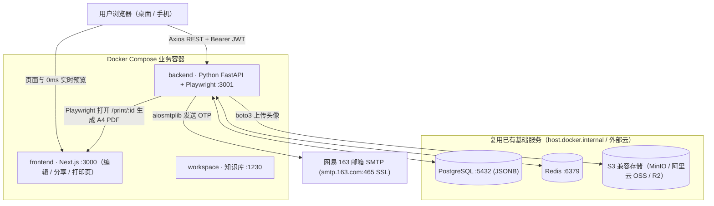

# CVory · 简序项目结构与服务设计规范

本文档定义简序（CVory）仓库的目录组织规范、`frontend/` 与 `backend/` 的模块划分约定，以及当前 Docker Compose 容器化服务的整体设计。上游产品与技术依据见 [技术选型与系统架构设计](workspace/content/design/02-技术选型与系统架构设计.md) 与 [在线简历制作执行计划](workspace/content/plan/01-在线简历制作执行计划.md)。

## 1. 仓库顶层结构

仓库采用**平级独立目录**组织，产品前端、产品后端与项目知识库各自独立管理依赖与构建，避免交叉耦合：

```text
/
├── frontend/            # 产品前端（Next.js + shadcn/ui Radix + Tailwind CSS + Axios + @umijs/openapi + Tiptap）
├── backend/             # 产品后端（Python FastAPI + uv + SQLAlchemy 2.0 + Pydantic v2 + Redis + S3 + Playwright）
├── workspace/           # 项目知识库（Fumadocs，独立构建与运行）
├── docker-compose.yml   # 仅编排 frontend / backend / workspace 三个业务容器
├── PROJECT.md           # 本文档：目录规范与服务架构设计
├── BACKLOG.md           # 产品工作项实施状态
└── README.md            # 仓库入口说明
```

**跨端协同原则**：
- **REST 契约单一来源**：由 `backend/`（FastAPI + Pydantic v2）自动暴露 OpenAPI JSON（`/api/openapi.json`），`frontend/` 使用 `@umijs/openapi` 自动生成请求函数与 TypeScript 类型。
- **单一现行数据契约与零历史包袱（NFR-CV-03 / SRC-CV-10）**：不做任何向后兼容，**不保留历史数据库迁移文件**（无 Alembic 迁移目录）；`frontend/` 与 `backend/` 严格校验现行契约版本号（`contract_version == 1`），拒绝不受支持的格式写入。
- **代码与设计规范**：`frontend/` 遵循 **Vercel 设计规范**（视觉、无障碍交互与 React / Next.js 工程最佳实践，配 Prettier + ESLint）；`backend/` 遵循 **Google Python Style Guide**（配 `ruff` + `pyright`）。

---

## 2. `frontend/` 目录设计规范

技术栈：`Next.js (App Router)` + `shadcn/ui (Radix UI)` + `Tailwind CSS` + `Axios` + `@umijs/openapi` + `Tiptap (MIT)` + `Prettier / ESLint`。

```text
frontend/
├── public/
│   └── manifest.webmanifest   # 应用清单
├── src/
│   ├── app/                   # Next.js App Router 路由层
│   │   ├── layout.tsx         # 根布局与字体
│   │   ├── page.tsx           # `/` 模板页（三款免费极简纸样对比、放大预览、使用模板）
│   │   ├── resumes/
│   │   │   └── page.tsx       # `/resumes` 我的简历（本机草稿与账号岗位多稿管理、JSON 导入导出）
│   │   ├── resume/
│   │   │   └── [id]/
│   │   │       └── page.tsx   # `/resume/:id` 自定义编辑器（左栏模块开关/自定义模块、中栏表单+头像+Tiptap/Markdown、右栏实时预览）
│   │   ├── share/
│   │   │   └── [token]/
│   │   │       └── page.tsx   # `/share/:token` 在线只读分享页
│   │   └── print/
│   │       └── [id]/
│   │           └── page.tsx   # `/print/:id` 纯净 A4 打印路由（供后端 Playwright 100% 像素级同源导出 PDF）
│   ├── components/
│   │   ├── ui/                # shadcn/ui (Radix Primitives) 基础组件，严禁混入业务逻辑
│   │   ├── editor/            # 模块管理栏、结构化表单、头像上传裁剪、Tiptap 富文本、Markdown 互转、排版工具栏
│   │   ├── preview/           # 唯一纸面模板组件（同时服务实时预览、分享页与 Playwright 打印页）
│   │   ├── templates/         # 模板对比卡、放大 Dialog、多稿管理列表
│   │   └── auth/              # 邮箱验证码 Dialog 与游客单稿认领
│   ├── services/              # @umijs/openapi 自动生成的 API 客户端（禁止手工修改）
│   ├── lib/
│   │   ├── api/               # Axios 实例、JWT Access/Refresh 自动续期拦截器
│   │   ├── contract/          # 单一现行简历 JSON 契约（含扩展预设模块与自定义模块）
│   │   ├── storage/           # 游客本机草稿缓存与防抖自动保存状态机
│   │   └── utils.ts           # 通用工具函数
├── e2e/                       # Playwright 端到端测试
├── openapi.config.ts          # @umijs/openapi 生成配置（指向 http://127.0.0.1:3001/api/openapi.json）
├── components.json            # shadcn/ui Radix 配置
├── next.config.ts             # Next.js 配置（standalone 输出）
├── Dockerfile
└── package.json
```

### 前端工程约定
1. **一套模板驱动预览与导出**：`components/preview/` 为唯一纸面真相源，编辑实时预览、只读分享页与后端 Playwright 打印页完全复用同一套 React/Tailwind 组件，保证所见即所得 100% 一致。
2. **Vercel 设计与工程规范**：高对比克制层级、无边框画布、4px 网格、蓝色键盘焦点，基础控件统一取自 `components/ui/`（shadcn/ui Radix）。
3. **接口生成目录只读**：`src/services/` 仅由 `pnpm openapi:gen` 生成；JWT 续期与错误处理收口在 `src/lib/api/`。

---

## 3. `backend/` 目录设计规范

技术栈：`Python 3.12+` + `uv` + `FastAPI` + `SQLAlchemy 2.0 (asyncpg / JSONB)` + `Pydantic v2` + `redis-py` + `aiosmtplib (网易 163 邮箱 SMTP)` + `boto3 (S3 兼容对象存储)` + `Pillow` + `Playwright (Chromium 浏览器池)` + `ruff` + `pyright` + `pytest`。

```text
backend/
├── app/
│   ├── main.py                # FastAPI 应用入口、lifespan（建表 + Redis + Playwright 浏览器池）、OpenAPI 路由
│   ├── core/
│   │   ├── config.py          # pydantic-settings 强类型环境变量配置
│   │   ├── contract.py        # 单一现行契约版本常量、模板白名单与简历 JSON 结构模型
│   │   ├── security.py        # 无状态 JWT Access/Refresh 签发与校验、OTP 哈希
│   │   └── logging.py         # 脱敏日志（严禁打印简历正文、验证码与真实邮箱）
│   ├── infra/
│   │   ├── database.py        # SQLAlchemy 2.0 async engine/session + 启动直接建表（无迁移文件）
│   │   ├── redis_client.py    # redis.asyncio 客户端封装
│   │   ├── mail.py            # aiosmtplib 网易 163 邮箱 SMTP 发信
│   │   ├── storage.py         # boto3 S3 兼容对象存储（阿里云 OSS / MinIO / R2）+ Pillow 头像压缩校验
│   │   └── pdf_renderer.py    # Playwright 常驻 Chromium 浏览器池 + 并发信号量限流输出 A4 PDF
│   ├── models/                # SQLAlchemy 2.0 ORM 模型（User / Resume / ResumeClaim，无 migrations/）
│   ├── schemas/               # Pydantic v2 请求与响应 Schema（驱动 OpenAPI 3.1）
│   ├── api/
│   │   ├── deps.py            # FastAPI 依赖注入（CurrentUser JWT + Redis 黑名单校验、DB Session）
│   │   └── routes/
│   │       ├── health.py      # /api/health 与 /api/health/ready（PostgreSQL + Redis 探活）
│   │       ├── auth.py        # /api/auth/*（OTP 发送/校验、Refresh 轮换、登出拉黑、/me）
│   │       ├── resumes.py     # /api/resumes/*（多稿 CRUD、版本号乐观锁自动保存、幂等认领、复制、JSON 导入导出、分享开关）
│   │       ├── share.py       # /api/share/{token}（公开只读分享获取）
│   │       ├── uploads.py     # /api/uploads/avatar（Pillow 压缩校验 + S3 兼容存储上传）
│   │       └── export.py      # /api/resumes/{id}/export/pdf & /api/export/pdf（Playwright 100% 同源 A4 PDF）
├── tests/                     # pytest + httpx 异步集成测试
├── pyproject.toml             # uv 依赖、ruff（Google Python 规范）、pyright 与 pytest 配置
├── Dockerfile                 # 基于 Python 3.12 + uv + Playwright Chromium
└── .env.example
```

### 后端工程约定
1. **Google Python Style Guide**：严格遵循 Google Python 风格，使用 `ruff check` / `ruff format` 与 `pyright` 做静态检查，所有路由、服务与依赖均须完整类型标注。
2. **零向后兼容与无迁移文件**：不创建 `alembic/` 迁移目录；`app/models/` 为唯一真相源，启动或命令按现行模型直接建表。
3. **强并发与安全防护**：
   - OTP 验证码加盐哈希落 Redis，同时限制邮箱冷却（60s）、邮箱每小时上限与 IP 每小时上限，5 次验证失败即作废；
   - 简历保存携带 `version` 乐观锁，避免多设备旧标签静默覆盖新内容；
   - Playwright 渲染通过 `asyncio.Semaphore` 限制并发页面数，复用单一常驻浏览器实例以严格控制内存。

---

## 4. 当前服务架构设计

Docker Compose **仅编排业务容器**，**PostgreSQL、Redis 与 S3 兼容对象存储（MinIO / 阿里云 OSS / R2）直接复用宿主机或外部已有服务**：

| 服务名 | 运行方式 | 端口 | 职责 |
| --- | --- | --- | --- |
| `frontend` | Docker Compose（`./frontend/Dockerfile`） | `3000` | Next.js 产品应用、实时预览、只读分享页与 `/print/:id` 纯净打印页 |
| `backend` | Docker Compose（`./backend/Dockerfile`） | `3001` | Python FastAPI REST API（`/api/*`）、OpenAPI（`/api/openapi.json`）与 Playwright PDF 导出服务 |
| `workspace` | Docker Compose（`./workspace/Dockerfile`） | `1230` | 独立 Fumadocs 项目知识库 |
| PostgreSQL | **复用宿主机已有服务** | `5432` | 存储用户、简历元数据、JSONB 文档内容、乐观锁版本号、认领幂等表与分享 Token |
| Redis | **复用宿主机已有服务** | `6379` | 存储 OTP 哈希、邮箱/IP 双维度限频与 JWT 登出黑名单 |
| S3 兼容对象存储 | **复用宿主机 MinIO 或外部 OSS / R2** | 环境变量配置 | 存储经过 Pillow 压缩校验的用户简历头像 |
| 网易 163 邮箱 SMTP | 外部邮件服务 | `smtp.163.com:465` (SSL) | 发送登录验证码邮件（授权码经环境变量注入） |


