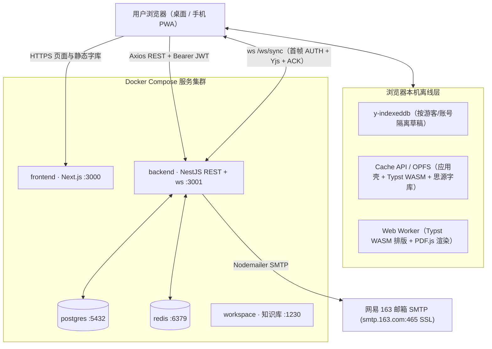

# CVory · 简序项目结构与服务设计规范

本文档定义简序（CVory）仓库的目录组织规范、`frontend/` 与 `backend/` 的模块划分约定，以及当前 Docker Compose 容器化服务的整体设计。上游产品与技术依据见 [技术选型与系统架构设计](workspace/content/design/02-技术选型与系统架构设计.md) 与 [在线简历制作执行计划](workspace/content/plan/01-在线简历制作执行计划.md)。

## 1. 仓库顶层结构

仓库采用**平级独立目录**组织，产品前端、产品后端与项目知识库各自独立管理依赖与构建，避免交叉耦合：

```text
/
├── frontend/            # 产品前端（Next.js + shadcn/ui Radix + Tiptap + Yjs + Typst WASM + PDF.js）
├── backend/             # 产品后端（NestJS + Prisma + PostgreSQL + Redis + 原生 ws Yjs 同步）
├── workspace/           # 项目知识库（Fumadocs，独立构建与运行）
├── docker-compose.yml   # 统一编排全部服务容器
├── PROJECT.md           # 本文档：目录规范与服务架构设计
├── BACKLOG.md           # 产品工作项实施状态
└── README.md            # 仓库入口说明
```

**跨端协同原则**：
- **REST 契约单一来源**：由 `backend/` 通过 `@nestjs/swagger` 暴露 OpenAPI JSON，`frontend/` 使用 `@umijs/openapi` 自动生成请求函数与 TypeScript 类型。
- **单一现行数据契约（NFR-CV-03）**：`frontend/` 与 `backend/` 各自维护现行契约版本号与校验逻辑，拒绝不受支持的旧格式写入，不做历史向后兼容。

---

## 2. `frontend/` 目录设计规范

技术栈：`Next.js (App Router)` + `shadcn/ui (Radix UI)` + `Tailwind CSS` + `Axios` + `@umijs/openapi` + `Tiptap (MIT)` + `Yjs` + `y-indexeddb` + `Typst WASM (@myriaddreamin/typst.ts)` + `PDF.js` + `Service Worker (Serwist / Workbox)`。

```text
frontend/
├── public/
│   ├── fonts/                 # 自托管完整开源 OFL 静态中文字库（思源黑体 / 思源宋体 Regular & Bold + OFL 许可）
│   └── manifest.webmanifest   # PWA 清单
├── src/
│   ├── app/                   # Next.js App Router 路由层（只做页面编排，不写重业务逻辑）
│   │   ├── layout.tsx         # 根布局、字体与全局 Provider
│   │   ├── page.tsx           # `/` 模板页（三款纸样对比、放大预览、使用模板）
│   │   ├── resumes/
│   │   │   └── page.tsx       # `/resumes` 我的简历（本机草稿与账号岗位多稿管理）
│   │   └── resume/
│   │       └── [id]/
│   │           └── page.tsx   # `/resume/:id` 编辑器（桌面三栏 / 手机填写与预览双视图）
│   ├── components/
│   │   ├── ui/                # shadcn/ui (Radix Primitives) 基础组件，严禁混入业务逻辑
│   │   ├── editor/            # 五章表单、Tiptap 富文本编辑器、排序/显隐控制、排版 Sheet
│   │   ├── preview/           # PDF.js 纸面渲染层、文本选择层、点击定位锚点覆盖层
│   │   ├── templates/         # 三款纸样展示卡片与放大 Dialog
│   │   └── auth/              # 邮箱验证码 Dialog、单稿认领与同步状态条
│   ├── services/              # @umijs/openapi 自动生成的 API 客户端（禁止手工修改）
│   ├── lib/
│   │   ├── api/               # Axios 实例、JWT Access/Refresh 自动续期拦截器
│   │   ├── contract/          # 单一现行数据契约版本常量、Zod 校验与快照类型
│   │   ├── yjs/               # Y.Doc 结构定义、y-indexeddb 命名空间隔离（游客/账号）、ws 同步客户端与 ACK 状态机
│   │   ├── pdf/               # Typst WASM Worker 封装、Tiptap AST -> Typst 安全映射、typst query 坐标解析、pdf-lib 兜底接口
│   │   ├── offline/           # 自托管字库按需拉取、Cache API / OPFS 持久化与离线就绪状态检测
│   │   └── utils.ts           # 通用纯工具函数（cn、文件名清洗等）
│   └── sw.ts                  # Service Worker 预缓存应用壳与静态运行时（保障 AC-CV-07 离线重开）
├── e2e/                       # Playwright 端到端测试（桌面、390px 移动端、键盘、离线与双设备同步）
├── openapi.config.ts          # @umijs/openapi 生成配置
├── components.json            # shadcn/ui Radix 配置
├── next.config.mjs            # Next.js 配置（standalone 输出、WASM 与 PWA 插件配置）
├── Dockerfile
└── package.json
```

### 前端工程约定
1. **组件与视觉**：严格使用 `components/ui/` 中的 shadcn/ui Radix 组件，遵循无边框、近白画布、4px 网格与蓝色键盘焦点规范（NFR-CV-02）。
2. **接口生成目录只读**：`src/services/` 仅通过脚本从后端 OpenAPI 重新生成；鉴权头、401 单飞刷新与错误处理统一收口在 `src/lib/api/`。
3. **重计算隔离**：Typst WASM 编译与 PDF.js 解析一律运行在 Web Worker 中，避免阻塞中文 IME 组合输入与表单交互；等待下载期间若快照序号变化立即取消旧任务。
4. **本地存储隔离**：游客草稿与不同登录账号的 `y-indexeddb` 数据库名按身份严格隔离；退出登录时立即断开 WS、清空内存 JWT 与预览缓存。

---

## 3. `backend/` 目录设计规范

技术栈：`NestJS (TypeScript)` + `@nestjs/swagger` + `Prisma` + `PostgreSQL` + `Redis` + 原生 `ws` + 无状态 `JWT` + `Nodemailer (网易 163 邮箱 SMTP)`。

```text
backend/
├── prisma/
│   ├── schema.prisma          # User / Resume / ResumeClaim / ResumeYjsUpdate / ResumeYjsSnapshot
│   └── migrations/            # Prisma 版本化迁移记录（禁止线上手工改表）
├── src/
│   ├── main.ts                # 启动入口、全局校验管道、Swagger/OpenAPI 导出、原生 ws 适配器
│   ├── app.module.ts          # 根模块组装
│   ├── config/                # 环境变量 Schema 校验（DB、Redis、JWT、163 SMTP 等）
│   ├── common/
│   │   ├── contract/          # 单一现行数据契约版本号与二进制/结构校验器（NFR-CV-03）
│   │   ├── guards/            # JWT Access Token 守卫（含 Redis 黑名单检查）
│   │   ├── filters/           # 统一错误响应结构
│   │   └── logger/            # 脱敏日志工具（严禁输出简历正文、验证码、真实邮箱）
│   ├── infra/
│   │   ├── prisma/            # PrismaService 生命周期封装
│   │   └── redis/             # Redis 客户端封装（黑名单、OTP 哈希、发送与错误限频）
│   └── modules/
│       ├── auth/              # 邮箱验证码发送/校验、JWT Access+Refresh 签发/轮换/登出拉黑
│       ├── mail/              # MailProvider 抽象 + Nodemailer 实现（联验/生产：网易 163 SMTP；开发：Mailpit）
│       ├── resume/            # 岗位多稿列表、新建、复制、改名、软删除墓碑、游客单稿幂等认领
│       └── sync/              # 原生 ws 网关、首帧 JWT 鉴权、Yjs 二进制同步、PG 事务落库与显式 ACK/DOC_DELETED 推送
├── test/                      # 单元、契约拒绝（CASE-CV-11）与双设备同步集成测试
├── nest-cli.json
├── Dockerfile
└── package.json
```

### 后端工程约定
1. **OpenAPI 驱动**：所有 Controller 与 DTO 必须标注完整的 `@nestjs/swagger` 装饰器与响应类型，确保前端 `umiopenapi` 生成零 `any`。
2. **敏感配置零入库**：JWT 密钥、数据库密码、Redis 密码及网易 163 邮箱账号与客户端授权码全部经环境变量注入；代码与日志中禁止出现真实凭证或用户隐私。
3. **幂等与强回执**：
   - 游客单稿认领通过 `ResumeClaim(userId, clientDraftId)` 唯一索引保证重试仅生成一份账号稿；
   - Yjs 同步更新必须在 PostgreSQL 事务提交完成后再下发 `ACK(resumeId, clientSeq)`，绝不先广播后落库。

---

## 4. 当前服务架构设计

当前系统以 **Docker Compose 自托管容器**形态运行，全部服务位于同一内部网络，职责与端口规划如下：

| 服务名 | 镜像 / 构建源 | 内部端口 | 职责与状态属性 |
| --- | --- | --- | --- |
| `frontend` | `./frontend/Dockerfile` | `3000` | Next.js 产品应用、PWA 应用壳、Typst WASM 静态资源与自托管思源黑体/宋体静态字库 |
| `backend` | `./backend/Dockerfile` | `3001` | NestJS REST API（`/api/*`）、OpenAPI 文档（`/api/docs-json`）与原生 WebSocket Yjs 同步服务（`/ws/sync`） |
| `postgres` | `postgres:16-alpine` | `5432` | 主持久化数据库（命名卷挂载），保存用户、岗位稿件元数据、认领幂等表、软删除墓碑及 Yjs 二进制更新/快照 |
| `redis` | `redis:7-alpine` | `6379` | 内存状态层，保存 OTP 验证码哈希（TTL）、邮箱/IP 发送限频计数、JWT 登出黑名单 |
| `mailpit` | `axllent/mailpit` | `1025` / `8025` | **仅本地开发 profile 启用**，捕获开发态验证码邮件并提供 Web 预览；联验与生产关闭该容器，直连网易 163 邮箱 SMTP |
| `workspace` | `./workspace/Dockerfile` | `3000`（宿主机 `127.0.0.1:1230`） | 现有 Fumadocs 项目知识库服务，与产品应用相互独立 |

### 服务拓扑与核心链路



### 三条核心运行链路

1. **认证与发信链路**：
   - 用户输入邮箱 → `backend` 校验 Redis 发送限频 → 生成 6 位 OTP 哈希写入 Redis（短 TTL、单次有效）→ 通过 `MailProvider`（生产/联验走网易 163 邮箱 `smtp.163.com:465` SSL + 授权码）发送验证码。
   - 验证通过后签发无状态 JWT Access Token + Refresh Token；退出登录时将 Token `jti` 写入 Redis 黑名单并立即断开该用户活跃的 WebSocket 连接。
2. **编辑与跨设备同步链路**：
   - 编辑内容实时写入本机 `Y.Doc` 与 `y-indexeddb`；登录稿件通过 `/ws/sync`（连接后首帧 `AUTH` 校验 JWT，不放 URL 参数）发送带 `clientSeq` 与契约版本号的 Yjs 二进制增量。
   - `backend` 校验契约、所有权与删除态后，在 PostgreSQL 事务中持久化更新并返回 `ACK(resumeId, clientSeq)`；前端仅在收到覆盖最新本机变更的 `ACK` 后才显示「已同步」。若稿件已在另一端删除，服务端推送 `DOC_DELETED` 阻止继续同步，前端允许用户先导出本机离线版本再清理副本。
3. **离线重开与 PDF 导出链路**：
   - Service Worker 缓存应用壳与 Typst WASM 运行时；进入编辑器后按当前稿件所需字重从 `frontend` 同源拉取思源黑体/宋体静态字库并写入 Cache API / OPFS。
   - 导出与预览共享同一份由 Web Worker 离线编译的 A4 PDF 字节与 `typst query` 条目坐标，全程不依赖服务端渲染或系统打印对话框。
