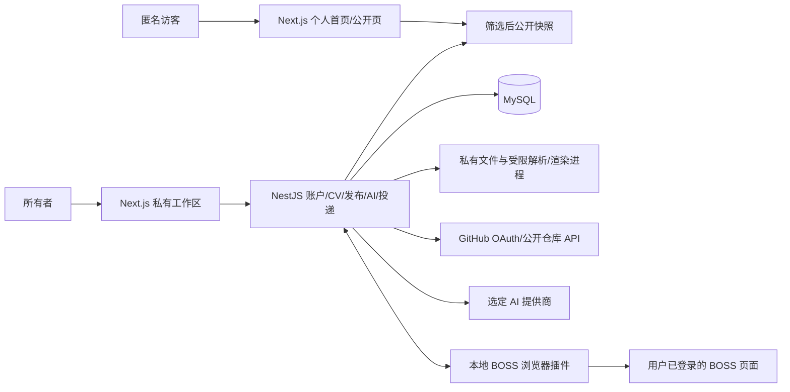

# CV 制作、管理、展示与投递设计

对应完整需求：[业务需求 04](../requirement/04-个人CV制作与管理需求说明.md)。这是该需求唯一的产品设计，按能力派生多份 PRD 和 Plan。性质：服务设计评审稿，负责人已授权按需求与设计开始实现；能力完成以 BACKLOG/HANDOVER 的证据为准。个人工具、GitHub 登录、富文本与 Markdown 编辑、MD/DOCX/文字 PDF 导入、PDF/PNG 导出、站主首页与 GitHub 项目、BOSS 插件和 AI 辅助为明确要求；扫描 PDF 首期提示不支持，OCR 后续再定。Next.js、shadcn/ui + Radix UI、NestJS + TypeScript 和 MySQL 已确定；管理界面视觉方向见根 DESIGN；从零绘制的布局与交互组织属于评审稿，不能将旧版画面当作已确认合同。其余配套工具及交互细化按文中区分基线、建议和待定项。调度见 BACKLOG。

## 1. 目标与范围

本设计定义完整目标合同；已明确方向、调研转化目标与待选技术按需求 04 区分，不能据此推断全部细节已获确认或全部实现。制作恢复、历史、导入与渲染的共用合同见第 7 节，完整验收映射见 §7.5。

简序 · CVory 是面向个人、使用者自行部署的开源简历与求职工具，首页展示站主选定简历及 GitHub 项目；账户数据继续隔离，不建设社区或招聘平台。新建或导入一份 CV，编辑保存，按用途复制、调整模板，再导出文件或明确发布；这些操作共用内容，不维护第二套人物资料。

原始输入通过[需求导航](../requirement/00-需求导航.md)追溯，竞品依据见[调研结论](../research/02-老鱼简历功能逆向与CV技术选型.md)。品牌、黑白灰、蓝色点缀、Geist 和视觉参数只在根 [DESIGN](../../DESIGN.md)维护。BOSS 直聘投递的自主实现方向见第 6 节；超出简历和岗位辅助的通用 AI、其他招聘平台、会员、多人协作、模板市场、博客与通用页面设计器不属于需求。

## 2. 共用设计

### 2.1 内容与保存

一份 CV 保存稳定 ID、名称、内容格式版本、结构化字段、富文本 JSON、模块顺序/可见性、头像及当前有效模板参数。姓名、公司和日期等是字段，职责、成果与简介是正文。模块包括基本信息、教育、工作、项目、技能、简介及可改名的补充模块。

富文本 JSON 是唯一编辑源。工具栏、Markdown 输入和粘贴都写入同一内容；支持段落、换行、加粗、斜体、列表、链接和行内代码。预览、PDF 和网页按共同规则渲染；未知格式明确提示并保留可读文字，不静默丢失或执行任意 HTML/脚本。Markdown 不承担简历版式。提供正文 Markdown 源码编辑与预览，受支持内容可反复切换；结构化字段使用表单维护，整份 .md 通过章节映射进入导入校对。切换前固定当前编辑草稿并检测不兼容格式，不能静默丢失原文或结构化字段。

字段与校验以本设计和对应 PRD 为准；纸张视觉见 [DESIGN §7](../../DESIGN.md#7-简历纸张与输出)。

保存只在持久化成功后确认；失败保留输入并可重试，中文组合输入不被打断。通过简单版本校验避免旧保存覆盖新内容，冲突时提示并保留本地修改，不做自动合并。重新打开保留内容及样式；隐藏不删除数据。

### 2.2 用途版本与样式

复制生成独立 CV，包含完整内容、显示状态和有效样式，后续互不追改。命名不充当对象 ID。普通删除需明确对象；当前公开来源先切换或撤回，不能连带静默撤站。编辑撤销、独立副本和修订历史是不同能力。历史恢复规则见 §7.2。

模板是少量共用内容的排版方式，个人样式是模板参数预设。管理工作台右侧直接展示标准单栏、紧凑单栏和时间索引三套模板，支持预览及使用；命名 Dialog 继续用于确认新简历名称和所选版式，不以弹窗替代模板浏览区域。不建设海量模板市场或模板收藏服务；参数和显示规则见 [DESIGN §7](../../DESIGN.md#7-简历纸张与输出)。应用预设时保存有效参数到 CV；以后修改/删除预设不能追改已有 CV。切换/恢复默认不丢正文，取消样式修改能还原。

### 2.5 管理工作区与共享页面壳

管理页使用统一的 `BasicLayout`，共用 Header、内容容器和 Footer；编辑器使用独立的沉浸式页面壳。视觉值与组件外观只在根 DESIGN 维护。

管理工作台的功能入口与任务组织参考老鱼简历，范围为简历管理、模板、Markdown、导入与公开展示；视觉使用根 DESIGN 的黑白灰风格，蓝色只作点缀。页面设计先同步 Figma，再调整实现。桌面左侧为已有简历与公开简历，右侧同时提供从模板新建、Markdown 简历和导入标签；手机按上下顺序组织。编辑器及其保存合同保持独立。

简历条目显示真实 A4 封面、名称、更新时间，提供编辑、分享／公开管理、复制、下载、改名和删除。数量使用真实总数，不引入参考站的 5 份配额。公开标签展示当前账户的单个公开结果及管理入口，不伪造多份公开简历模型。分享进入筛选预览与明确确认流程，不直接发布。

模板卡片使用合成内容作预览，确认后新建空白 CV；示例不混入真实内容。Markdown 入口复用受限解析与候选校对，接受粘贴或文件导入，确认后另存。导入格式、大小和失败保留规则见 §2.3。实现与验证范围见 BACKLOG／HANDOVER，不将 Figma 静态状态当作运行证据。

### 2.3 导入与导出

导入先校验文件，再解析成候选，保留未归类文字供校对，确认后另存私有 CV。文件流程的界面表达见 [DESIGN §6](../../DESIGN.md#6-项目场景)；Figma 中的格式和限额不替代实施合同。解析失败、取消或重复确认不覆盖旧 CV、不自动公开。原始文件和解析中间结果不默认长期保存；MD、DOCX 与有文字层 PDF 是必需格式，具体解析链见 §4.3。

JSON 是可恢复备份，包含声明支持的内容、样式、可见性及头像资源，不包含认证或公开发布状态。Markdown 交换正文语义，不保留精确模板/分页；不能将依赖原站私有地址的备份称为完整备份。

PDF 从同一个已保存输入和有效样式生成，生成期间继续编辑不能混入。等待字体/头像就绪，A4 支持多页，文字可选、可搜、可复制，链接有效；不裁字、不混入 UI 或水印，不强制缩到一页。打印样式与编辑控件隔离，不另建导出历史系统。PNG 建议由同一份 PDF 逐页栅格化，单页下载 PNG、多页按页码打包 ZIP；这是输出实现建议，不能以首屏截图代替完整多页结果。

### 2.4 公开展示

只有所有者可以管理，访客只读。目标以 GitHub 登录，服务端验证会话并隔离账户数据；存量邮箱账户按第 5 节安全绑定。 账户菜单、资料设置、登录状态、公开管理和访客阅读的界面评审方案集中在 [DESIGN §6](../../DESIGN.md#6-项目场景)，不将原型状态视为实现。账户系统的现状、目标与待定方案见第 5 节。

采用显式发布：从已保存 CV 选择公开字段，生成一份筛选后的当前公开结果；保存草稿不发布，发布失败保留旧结果。公开页和匿名数据只读取该结果，不能先传完整 CV 再隐藏；头像、缓存和资源地址也遵循公开选择。

首页 `/` 采用站主个人主页：姓名、职业标题、简介和联系方式在首屏，随后为技能、经历、精选项目及教育，可通过页内目录查阅；GitHub 链接只使用明确公开的项目。个人稳定页建议沿用 `/u/{publicId}`，私有管理建议使用 `/workspace`，不占用访客首页。站主由部署配置绑定内部 owner ID，不能以“第一个登录者”认领；未选站主或未发布时展示空状态，不显示私有信息。两条公开路由读取同一筛选后快照，首页不维护第二份简历。手机自然重排，正文不是 A4 图片。撤回后本站页面、数据及相关资源停止返回该简历；不能承诺召回访客已下载副本。访客 PDF 下载不在范围内，不能复用私有导出地址。

公开结果有单调版本；候选绑定来源 CV 的 etag、筛选规则与创建时的公开版本。确认发布和撤回都做条件更新，旧版本拒绝并保留当前结果；撤回仍保留版本水位，防止延迟请求复活内容。删除当前来源在服务端事务内检查，必须先切换或撤回；不能只在界面禁用。

## 3. 能力拆分

### 目标与现有实现的边界

本节描述可延用的工程基础；当前授权范围是需求、调研和服务设计，不启动代码、数据库或部署变更。现有邮箱密码、JSON/Markdown 和 PDF 代码不能当作目标 GitHub、DOCX/PDF 导入、PNG、AI 或插件已经实现。

- 身份、会话与账户隔离的现状和目标见第 5 节。
- CV、样式预设、公开结果按账户隔离。增加 owner_id 时使用显式数据库迁移，旧数据保留为 legacy owner，不自动归给首位注册者。
- 保持 profile／sections／styleSettings JSON，增加结构化起止月份、学历、部门、项目链接、字段可见性和照片裁切参数，兼容既有 title／subtitle／dateRange。NestJS DTO/OpenAPI 与生成客户端作为对外接口来源。
- Server Component 承担路由和静态内容；表单、账户状态、菜单和 Tiptap 保持必要的客户端边界。BasicLayout 与独立 EditorLayout 共享语义变量和基础控件；ResumeDocument 供封面、编辑预览、公开内容与打印复用。
- 保存固定提交内容；响应不得覆盖处理中继续输入的内容，也不得误标已保存。冲突保留本地，可另存副本或明确加载服务器版本。
- 账户头像与每份 CV 证件照分别保存。照片使用受限图片内容，3:4、位置、显隐和裁切参数随 CV 保存；未选择公开的照片不进入匿名结果。
- 导入目标采用 CVory v1 JSON、Markdown、DOCX 与文字型 PDF，JSON/MD 延用现行 10 MB，DOCX/PDF 单文件建议也为 10 MB，DOCX 解压体积、PDF 页数与解析预算还需按样本验证；候选可校对，确认另存。JSON 包含照片内容、样式和可见性，不含账户、会话和发布状态；Markdown 保留受支持正文语义，不承诺分页。
- 公开预览由服务端从指定 etag 的已保存 CV 筛选成短期候选；发布提交候选标识，失败保留旧结果。匿名端只返回筛选后的结果，来源名称仅所有者可读；撤回后不缓存或返回旧内容。
- PDF 固定已保存内容，通过短期随机打印上下文让受控 Next.js 路由复用 ResumeDocument，Node.js Playwright Chromium 生成可选文字 PDF。禁止用户指定 URL／HTML，上下文完成清理；部署需安装 Chromium。

| 可独立交付的结果 | PRD | Plan |
| --- | --- | --- |
| 新建、编辑并可靠重开 CV | [01 CV 制作与保存](../prd/01-CV制作与保存.md) | [01](../plan/01-CV制作与保存.md) |
| 独立维护用途版本及历史恢复 | [02 CV 版本管理](../prd/02-CV版本管理.md) | [02](../plan/02-CV版本管理.md) |
| 切换模板与管理个人样式 | [03 模板与样式管理](../prd/03-模板与样式管理.md) | [03](../plan/03-模板与样式管理.md) |
| 从文件校对并新建 CV | [04 简历导入](../prd/04-简历导入.md) | [04](../plan/04-简历导入.md) |
| 恢复备份或交换正文 | [05 备份与 Markdown 导出](../prd/05-简历备份与Markdown导出.md) | [05](../plan/05-简历备份与Markdown导出.md) |
| 获得 PDF 与 PNG | [06 PDF 导出](../prd/06-PDF导出.md) | [06](../plan/06-PDF导出.md) |
| 控制并展示公开简历 | [07 个人简历展示](../prd/07-个人简历展示.md) | [07](../plan/07-个人简历展示.md) |
| 账户访问与资料 | [08 账户访问与资料](../prd/08-账户访问与资料.md) | [08](../plan/08-账户访问与资料.md) |
| 存量邮箱验证与账户恢复 | [09 邮箱验证与账户恢复](../prd/09-邮箱验证与账户恢复.md) | [09](../plan/09-邮箱验证与账户恢复.md) |
| 账户注销与数据处理 | [10 账户注销与数据处理](../prd/10-账户注销与数据处理.md) | [10](../plan/10-账户注销与数据处理.md) |
| 固定简历并核实 BOSS 投递结果 | [11 BOSS直聘自主投递](../prd/11-BOSS直聘自主投递.md) | [11](../plan/11-BOSS直聘自主投递.md) |
| 获得可审阅的 AI 诊断与岗位建议 | [12 AI简历分析与岗位匹配](../prd/12-AI简历分析与岗位匹配.md) | [12](../plan/12-AI简历分析与岗位匹配.md) |

基础工程和持久化并入首个制作能力，通用检查随各能力执行，不为技术层和整体验收再建立产品 PRD。一个能力确实需要多个独立执行步骤时，可继续拆 Plan，不要求各层数量相等。

## 4. 技术选型

### 4.1 已固定的前端基线

前端采用 Vercel Web Interface Guidelines/Geist 的设计与交互方向，shadcn/ui Radix 的组件实现；负责人指定的两份 shadcn 技能纳入实施规则，视觉与交互唯一维护在根 DESIGN，工程目录/代码唯一维护在 PROJECT。现有 shadcn CLI info 核对为 radix-nova/Radix、Tailwind v4、Lucide、@/ 别名；不重设 preset 或替换原语库。

依据负责人要求固定前端，以下作为 MVP 工程基线；这是已选方案，不表示依赖已经安装或通过集成验证。采用已列版本线的稳定补丁，具体依赖和字体文件版本在建立工程时精确锁定。

| 部分 | 固定选择 | 用途与边界 |
| --- | --- | --- |
| 框架 | Next.js 16.x App Router + React 19.x | 私有管理与公开展示共用一个应用；react/react-dom 版本一致 |
| 语言 | TypeScript 5.9.x，strict | 选择兼容的稳定版本线，不以最新版本号替代集成验证 |
| 样式 | Tailwind CSS 4.x | 使用根 DESIGN 的语义颜色和尺寸，不混入其他整套样式框架 |
| 组件 | shadcn/ui + Radix UI | 显式选择官方 Radix 组件系列，使用其无样式交互原语；组件源码纳入工程，不混入 Base UI 系列 |
| 编辑器 | Tiptap 3.x | 受限富文本和 Markdown 输入，JSON 为权威源；公开页用静态渲染，按需加载编辑器 |
| 表单与校验 | React Hook Form 7.x + Zod 4.x | 重复经历表单和校验；同一内容不复制成多份独立保存源，服务端仍须校验 |
| 字体 | Geist Sans + Noto Sans SC，Geist Mono 按需 | 固定中西文字体来源，预览与打印复用；字体文件和覆盖范围在工程初始化核对 |
| 状态 | React 局部状态、表单状态和 Tiptap 状态 | 首版不增加全局状态库或远端查询框架，出现具体共享需求再评估 |
| 工具链 | Node.js 24 LTS + pnpm 12.x | Node 用于前端开发、构建与 Next.js 渲染；工程初始化固定 packageManager 和单一 pnpm-lock.yaml |

固定的是技术组合与版本线。初始化时把精确版本写入工程清单及锁文件，记录 shadcn 初始化工具与组件来源，运行实际类型检查、构建和核心流程；不为设计评审创建占位工程清单。兼容的补丁升级按实际验证处理，跨版本线或更换框架先更新本设计。

Tiptap 的官方 Markdown 扩展当前标为 beta，编辑器选择固定不等于任意 Markdown 都可无损转换；只评估受支持子集并验证往返。JSON 保存和静态渲染保持不变，转换异常要明确处理，不能静默删内容或改成两套编辑源。Next.js 中编辑器在客户端正确初始化，公开页不加载编辑环境。

### 4.2 已确定的服务与数据边界

负责人指定后端使用 **NestJS + TypeScript**，代码以 Google TypeScript Style Guide 为基线，MySQL 保留。Next.js 负责界面、SSR 与共用模板；NestJS 独立负责业务/API，不在 Next.js Route Handlers/Server Actions 再建一套鉴权与数据库写入。backend/ 唯一运行时为 NestJS，历史 Python 由 Git 承载；源码与运行配置统一不表示业务库已迁移或生产已部署。

| 部分 | 选择及性质 | 职责与边界 |
| --- | --- | --- |
| 业务服务 | NestJS + TypeScript strict，已确认 | Module/Controller/Service 按业务分工，负责账户、CV、版本、文件、发布、AI 与插件任务；Nest 稳定版本及适配器在实施时验证锁定 |
| 数据库 | MySQL，沿用已选基线 | 业务标识/状态用普通列，正文用 JSON；保留 owner、public ID、时间、版本与原表语义，不重置存量数据 |
| 数据访问 | 首个迁移切片采用 mysql2 Promise 驱动与参数化 SQL | 直接兼容现有 MySQL 表，数据库 provider 管理连接和事务；owner+etag 条件更新检查影响行数。ORM 尚不引入，避免迁移时自动重建 schema |
| 迁移 | 显式版本化 SQL 与迁移记录 | 在隔离库验证后显式执行，保留存量表/ID/凭据；启动不自动建表，禁止 reset/drop 替代兼容迁移 |
| 工程 | Node.js 24 LTS + TypeScript + pnpm | backend/ 独立清单/锁文件，复用前端语言生态；精确版本和真实脚本在实施后登记，不创建占位工程 |
| API | DTO + class-validator/ValidationPipe + @nestjs/swagger | 明确运行时校验、operationId、响应白名单与统一错误；前端仍由 OpenAPI 生成 axios 调用，不直接共享 ORM 类型 |
| 身份 | GitHub OAuth + NestJS 会话 Guard | 会话与 owner 在服务端校验，存量绑定见第 5 节；Next.js 与插件不持有 OAuth/model secret |
| 文件/任务 | 私有目录及受限独立 Node 进程，建议 | 解析/渲染与 HTTP 故障隔离，MySQL 保存必要状态；过期清理、预算和授权不因使用 Promise 就自动成立 |

Google TypeScript 约束代码风格，NestJS 组织模块与依赖，Google API 约束接口；详细目录、文件命名、依赖方向与代码规则唯一维护在 PROJECT。工程与编码规范见 [PROJECT §3.1](../../PROJECT.md#31-后端-typescript-与-nestjs-规范)和[§3.4](../../PROJECT.md#34-工程目录与依赖边界)。建议按 Account、CV、Files、Publication、GitHub、AI、Delivery 实际需要建立业务模块，不按每个按钮拆模块，不新增微服务平台。

同一站点入口将 /api/ 转发至 NestJS，其余由 Next.js 提供；SSR 经受控内网地址请求 NestJS。本站 Cookie、CSRF、owner 授权与私有禁止共享缓存的合同保持。provider 默认单例不得保存当前 owner；数据库事务、CAS、请求幂等和设备租约仍需显式实现。重型解析/图像处理使用有超时及资源边界的子进程，避免阻塞 Node 主事件循环；框架异步不等于 CPU 任务隔离。

### 4.3 内容、文件与 PDF 的协作

Tiptap JSON 是正文权威源，NestJS 校验内容格式版本、受支持节点、字段及大小后保存；前端 Zod 用于即时反馈，不替代后端校验。Markdown 与 JSON 的转换及只读渲染共用受控 TypeScript 内容适配器，保持统一节点/转换规则；不从后端跨目录导入前端源码。

文件处理建议按以下链路落实，均生成同一种可校对候选，不直接创建正式 CV：

| 输入 | 建议解析位置和方式 | 保真与失败边界 |
| --- | --- | --- |
| MD / CVory JSON | 浏览器复用有界确定性适配器 | Markdown 章节映射为结构化模块、正文转 Tiptap；JSON 校验版本；格式损失先提示，不能依赖 AI 才导入 |
| DOCX | NestJS 调度受限 Node 任务，建议 Mammoth | 提取语义 HTML/文字和转换警告，经白名单清洗后映射字段与 Tiptap；保留段落/表格顺序及无法映射原文，复杂布局不承诺还原 |
| 有文字层 PDF | NestJS 调度受限 Node 任务，建议 PDF.js/pdfjs-dist | 按页提取文字及位置、重建行/模块候选；多栏/表格顺序需校对，保留页码原文，不编造经历；无文字层提示扫描件不支持 |

Mammoth 不自动清洗来源文档；转换产物不能直接注入页面，外部文件访问保持关闭，链接/图片与内嵌 HTML 经同一白名单/资源限制处理。PDF.js Node 依赖、CMap/字体/WASM 资源和模块格式须在目标容器验证；不以提取到文字就声称多栏归类准确。

候选包含来源格式、原文片段/页码、字段映射与警告；确认后前端共用适配器转为规范正文，服务端再次校验并幂等另存。必要时可将未归类文字留作补充模块。DOCX/PDF 原件只进入私有临时目录，按解析成功、取消、超时及明确 TTL 清理；不得通过公开地址或任意远程 URL 输入。按文件签名、压缩展开体积、页数、节点数、时间与内存设置预算；具体上限属于实施前样本验证，不把 10 MB 上传限制当作解析资源上限。

备份由后端组装内容与照片；Markdown 导出使用已保存版本与同一前端适配器。富文本/Markdown 切换采用受支持子集的双向转换，不能仅以 Markdown 输入快捷键当作源码编辑模式。Tiptap 官方 Markdown 扩展仍标 beta，是否引入需与现有适配器比较并验证，不在设计阶段新增依赖。

PDF 建议采用 Node.js/TypeScript Playwright + 匹配的 Chromium。NestJS 固定已保存 CV、有效样式与资源，建立请求内或短期有效的私有导出上下文；浏览器访问受保护的 Next.js 内部打印视图，复用 React 模板和字体后生成文件。打印视图读取固定输入，不能重新读取正在变化的草稿；上下文仅供本次导出使用，完成或超时清理，不形成导出记录中心。NestJS 不另写一套简历排版。

渲染地址由服务端固定，不能接收任意用户 URL/HTML；私有打印入口不向访客开放，也不把长期凭据放在 URL。等待字体与头像就绪，限制文件大小、处理时间及并发，异常可重试。浏览器/页面由受控任务创建和释放，配置固定内部地址、资源预算及退出清理，不在请求间复用可变用户上下文。

Next.js 与 NestJS 是两个运行进程，MySQL 和私有文件需要独立持久化及备份。建议采用支持 Node 和 Chromium 的长驻容器环境，前后端独立进程；使用 Vercel 托管前端时仍需另行部署 NestJS/MySQL，验证内部打印入口、访问保护及资源加载。Next.js 选择不等于已确定全部部署到 Vercel。首期不增加 Redis、外部消息队列或任务平台。

PNG 建议使用 PDF.js 的 Node 渲染链（[官方 PDF→PNG 示例](https://github.com/mozilla/pdf.js/blob/master/examples/node/pdf2png/pdf2png.mjs)）从同一固定 PDF 按页渲染，使用受支持的 Node Canvas 后端。独立进程控制总页数/像素、内存、时间与并发；依赖所需 native/字体资源须在容器验证。建议默认 144 DPI（A4 约 1191 × 1684 px），具体清晰度与上限待样本验证；单页 PNG、多页 ZIP，循环全部页面，不只输出示例中的第一页。PDF 是正式分页依据，PNG 不再独立排版。不为文件处理保留第二套 Python 业务服务。

### 4.4 Google API 设计约定

Google API 通用规范唯一维护在 [PROJECT §3.3](../../PROJECT.md#33-api-规范)，NestJS/TypeScript 代码规范见 [PROJECT §3.1](../../PROJECT.md#31-后端-typescript-与-nestjs-规范)。CV、样式预设和当前公开结果按该规范定义资源；保存、独立副本、导出和发布仍遵循第 2 节的业务边界。具体资源字段、迁移及端点随对应能力在本设计内细化，再同步对应 Plan，不另建通用资源框架。

### 4.5 验证边界与官方依据

已确定技术组合不代表完成安装和集成。具体版本以锁文件为准，登录、文件格式和限额按本文目标及对应实施评审；部署与备份位置按运行环境配置；配套工具是简单维护目标下的工程建议。模板及参数按第 2 节与根 DESIGN；保存恢复、历史和跨格式扩展按第 7 节；访客 PDF 不纳入范围。技术选择不自动增加业务能力。

- 前端：[Next.js 安装与系统要求](https://nextjs.org/docs/app/getting-started/installation)、[React 版本](https://react.dev/versions)、[TypeScript 5.9](https://www.typescriptlang.org/docs/handbook/release-notes/typescript-5-9.html)、[Tailwind/Next.js](https://tailwindcss.com/docs/installation/framework-guides/nextjs)、[shadcn Radix 组件](https://ui.shadcn.com/docs/components/radix/select)、[React Hook Form](https://react-hook-form.com/get-started)、[Zod](https://zod.dev/)、[Node 支持周期](https://nodejs.org/en/about/previous-releases)、[pnpm](https://pnpm.io/installation)。版本线是项目基线，不声称全部都是最新版本。
- 内容与字体：[Tiptap Next.js](https://tiptap.dev/docs/editor/getting-started/install/nextjs)、[JSON 持久化](https://tiptap.dev/docs/editor/core-concepts/persistence)、[Markdown beta](https://tiptap.dev/docs/editor/markdown)、[Next.js 字体](https://nextjs.org/docs/app/getting-started/fonts)、[Noto CJK](https://github.com/notofonts/noto-cjk)。
- 服务与数据：[NestJS 模块](https://docs.nestjs.com/modules)、[ValidationPipe](https://docs.nestjs.com/techniques/validation)、[OpenAPI](https://docs.nestjs.com/openapi/introduction)、[Prisma/Nest](https://docs.nestjs.com/recipes/prisma)、[存量库 baseline](https://www.prisma.io/docs/orm/prisma-migrate/workflows/baselining)、[MySQL 8.4](https://dev.mysql.com/doc/refman/8.4/en/)。
- 规范：[Google API Design Guide](https://docs.cloud.google.com/apis/design)、[资源 AIP-121](https://google.aip.dev/121)、[更新 AIP-134](https://google.aip.dev/134)、[自定义方法 AIP-136](https://google.aip.dev/136)、[并发 AIP-154](https://google.aip.dev/154)、[分页 AIP-158](https://google.aip.dev/158)、[错误 AIP-193](https://google.aip.dev/193)。
- 文件：[Node Playwright PDF](https://playwright.dev/docs/api/class-page#page-pdf)、[Mammoth](https://github.com/mwilliamson/mammoth.js)、[PDF.js](https://github.com/mozilla/pdf.js)。这里只核对设计依据，未安装依赖或验证本项目文件链。

## 5. GitHub 身份、项目与存量账户

### 5.1 身份和会话

目标只需 GitHub 登录，新用户不另设本地密码或邮箱验证门槛。建议 OAuth Web Authorization Code 流程，由 NestJS 完成随机 `state`、PKCE S256、授权码交换和 GitHub `/user` 身份校验，再签发本站 HttpOnly/Secure/SameSite 会话 Cookie。回调仅允许登记地址，`state` 单次短期有效，回跳限制本站路径；OAuth 失败不改变账户或原编辑输入。Next.js 不持有 client secret 或向浏览器返回 GitHub access token。

使用 `(provider=github, provider_user_id=GitHub 数字 ID)` 唯一映射内部账户；login/显示名/头像可变，不充当所有权主键。无需公开邮箱，默认不申请 `repo` 写权限、私有库或组织权限；读取本人公开资料与公开仓库所需最小范围即可。GitHub App 与 OAuth App 都可实现 OAuth；个人工具首期建议 OAuth App，若扩展私有仓库再评估 GitHub App，不同时维护两套认证产品。

GitHub 授权仅证明身份，不能自动公开简历、同步仓库到网页或授予 BOSS 发送。服务端 owner 校验覆盖 CV、历史、文件、AI、发布及插件任务；账号切换不接续他人的本机草稿或设备授权。会话过期/登出/撤销按本站会话处理；GitHub 不可用时已有匿名公开快照可读，过期会话无法绕过重登。

### 5.2 存量账户绑定与数据迁移

当前 `accounts.email` 与 `password_hash` 非空，现有注册、邮箱验证/找回与注销代码仍以邮箱密码运行；GitHub 尚未实现。建议保留内部 owner/public ID，新增独立身份映射并使 GitHub-only 账户的邮箱、密码可空，不能填假邮箱/假密码绕过约束。迁移先在隔离 MySQL 备份及验证，不改真实数据。

存量用户先用原登录方式证明账户归属，再完成 GitHub OAuth，双方会话和意图核对后绑定；同邮箱不自动合并，已绑定另一 owner 的 GitHub 身份拒绝抢占。GitHub-first 新账户与存量账户冲突须明确处理，不直接搬数据。新产品入口收敛为 GitHub；邮箱兼容入口的退场时间需在资料绑定完成后另定，不能删除未迁移用户的唯一访问方式。

[PRD 09](../prd/09-邮箱验证与账户恢复.md)与其 Plan 仅维护仍启用邮箱凭据的存量兼容；GitHub-only 的身份恢复由 GitHub 提供，不套用本地忘记密码。发布条件建议为 active 且具有已核验 GitHub 身份；邮箱未公开不阻塞新用户发布。存量未绑定账户沿用其原发布门槛，不能借迁移自动声明邮箱已验证。

存量邮箱兼容的技术合同继续保留：密码 8–128 字符，单向哈希存储；邮箱验证链接 24 小时、密码重置链接 30 分钟。令牌高熵、仅存哈希、绑定 owner/目的/目标邮箱、单次原子消费与过期校验；GET/邮件扫描不改变状态，重发失效旧链接。重置限已验证邮箱，公开请求一致反馈；成功重置撤销旧会话和其他重置凭据，改密码核验原密码并轮换会话。邮件按持久任务重试/清理，日志无凭据，“服务商接受”不等于收件。不得通过邮箱恢复接管不同的 GitHub owner。上述仅维护仍启用的存量凭据，真实邮箱与闭环未验收不声称通过。

### 5.3 GitHub 项目素材与发布

服务端读取公开仓库列表并分页，建议保存仓库稳定 ID、owner/name、URL、简介、语言、stars、fork 标识、同步时间和来源；支持搜索/选择，不自动收录所有仓库。人工职责、成果、排序和显隐独立保存，刷新远端只更新来源元数据，不覆盖人工整理；导入项目经历须经确认。

先选仓库 → 补充个人贡献 → 加入 CV 或主页候选 → 预览公开字段 → 明确发布。主页只读取冻结的项目公开结果，不向访客实时转发带 token 的 GitHub 请求。仓库变更/转私有/删除时下次刷新提示，用户可撤回项目；不承诺自动即时发现。缓存可使用 ETag/限流退避，失败保留上次数据并标记时间，不虚构实时状态。首期不抓源码、不读私库，不从 stars 推断贡献。

### 5.4 生命周期和运行边界

账户仍按 owner 隔离并可备份、注销；建议延用 7 天等待期和删除墓碑防恢复复活的既有合同，具体清理与保留范围按 [PRD 10](../prd/10-账户注销与数据处理.md)。GitHub-only 注销/取消使用同一数字 ID 的新近 OAuth 身份核验，不能要求不存在的密码；不关联另一 GitHub 账号。注销冻结任务，撤销设备、会话和保存的 provider token，清理 AI 私有输入/输出与项目素材，不承诺召回平台已发材料或访客副本。

现有凭据不自动删除或放宽；TLS、Cookie、CSRF、可信代理、限流、缓存和日志脱敏继续由服务端落实。GitHub token 如非必要不长期保存；需要刷新时加密存储、最小范围、可撤销并限制到 GitHub 固定域名。恢复与可用性目标须经部署环境验证，不从本地测试推导公网容量。

依据：[GitHub OAuth / PKCE](https://docs.github.com/en/apps/oauth-apps/building-oauth-apps/authorizing-oauth-apps)、[公开仓库列表](https://docs.github.com/en/rest/repos/repos#list-repositories-for-a-user)。方案为评审建议，尚未建立 OAuth 应用或执行迁移。

## 6. BOSS 直聘投递自主实现方向

自主维护任务与适配器是已确认方向，允许改造开源模块；不引入上游的第二套账户和简历系统。证据见[调研 03](../research/03-BOSS直聘自动投递简历方案与自研可行性调研.md)。下列是目标合同；首期只支持 Chrome，PDF 由用户手工上传，插件负责岗位筛选及招呼；建议 Manifest V3 侧栏，上游代码仅选择性参考，分发方式待选。

### 6.1 产品流程与边界

选择已保存 CV 固定版本 → 生成/下载 PDF，由用户在 BOSS 官方页面手工上传并自行核对 → 插件按关键词读取/筛选岗位 → 可选 AI 匹配与招呼草稿 → 核对岗位集合、平台身份、招呼及动作范围 → 用户启动有限沟通/招呼任务 → 查看逐岗位结果。上传 PDF 是独立人工步骤，不把缺乏平台上传回执当作插件发送失败，也不在首期验收中要求自动上传/附件发送。仅准备任务不会发送；相同简历的公开发布、备份、修改和恢复不授予投递权限。平台账号由用户在自己控制的环境登录，不向 CVory 提交账号密码。

首期采用浏览器插件方向，建议 MV3 侧栏负责规则/候选与执行反馈，content script 读取当前岗位页面、受控适配建立沟通和招呼发送，service worker 管理配对与消息。用户自部署后端保存 CV、偏好、AI 报告、任务与结果；BOSS Cookie 留在用户浏览器，不上传或远端托管。插件仅申请 BOSS 和本站必要域名及 storage/sidePanel 等最小权限，不请求全站浏览历史。网页与扩展消息校验来源、结构、任务 owner 与 nonce，不把任意页面消息当发送授权。手机可管理任务及查看结果；需要本地桌面执行的场景说明设备要求，不伪称手机可后台发送。执行器离线不阻塞简历制作。

关键词偏好包含职位词（OR）、排除词、城市、薪资区间、经验/学历要求及公司排除；同一维度语义在界面展示，必需条件缺失进入待核对。流程为硬条件过滤 → 去重 → 可选 AI 匹配/解释 → 用户核对有限集合 → 启动；AI 不放宽必需条件。数量、运行时长、间隔和同公司/HR 重复策略作为可见配置，不能把上游随机间隔当作平台许可阈值。服务端和插件都限制本次集合，新增目标需重新确认。

### 6.2 数据与状态

| 对象 | 最小合同 |
| --- | --- |
| 岗位候选 | 平台、稳定岗位标识或规范链接、职位／公司及读取时间；信息可能过期，不虚构实时职位状态 |
| 投递任务 | owner、固定 CV id／etag、内容与有效样式快照、可选 PDF 标识/摘要及人工上传说明、所选平台账户标识、岗位集合、动作范围、招呼文本、授权时间及状态 |
| 执行动作 | 任务项、岗位、动作类型、幂等键、尝试序号、执行租约、时间、结果及受限证据；首期动作类型仅建立沟通和招呼文字；人工 PDF 上传另记用户说明及来源 |
| 本地连接 | 绑定当前 CVory owner、设备和平台账户；短期配对凭据可撤销，不上传平台 Cookie，不接受客户端 owner 作为授权依据 |

人工材料准备状态独立记录：未记录/待人工处理/用户确认已上传，带确认时间及所选 CV/PDF 标识；不把用户确认转成平台 confirmed。首期插件不领取附件动作、不获取 PDF 内容，不申请额外文件读取权限、不触发附件上传动作，也不发送 PNG 替代。未来自动附件是独立扩展，另行确认和验收。

任务状态为 draft／ready／running／paused／needs_user／completed／cancelled；completed 只说明已授权的沟通/招呼任务不再运行，不代表附件送达。动作状态为 pending／running／confirmed／failed／unknown／skipped；界面明确待处理、失败和未知数量。平台回执或可复核页面／会话事实才可确认相应动作；没有送达证据不能将 confirmed 扩展为已读或回复。

任务启动固定输入；CV 更新不追改任务。使用稳定幂等键和原子领取，执行器须独占租约；重连、租约丢失、回执丢失或请求超时先核查远端状态，禁止自动重放 unknown。新的执行器未核对在途动作前不得接管发送。停止阻止后续动作，不承诺撤销已发生的外部发送。

### 6.3 异常、隐私与接入

登录失效、验证码、平台限制、岗位关闭、人工材料仍需处理或账号切换均暂停相关项并说明下一步。账号与任务绑定不一致时重新核对授权；暂停、恢复和取消本身幂等。招呼结果与人工材料状态分开，界面可提示后续到 BOSS 人工处理附件；不报告“PDF 已投递”或“简历附件已送达”。

任务、PDF、连接及证据均按 owner 隔离；日志不记录 Cookie、凭据及完整简历。注销冻结任务并撤销设备绑定，历史快照、投递材料及证据纳入同一所有权清理；不能撤回招聘平台已保存材料。证据保留期随部署隐私策略选定，发布前不得无限保存。

建议优先参考 jitou 的 MV3 侧栏和分动作确认；其发送为图片/文字、读取可变本地图片、批次启动清空去重记录，不能承担固定 PDF 或跨任务去重。CVory 自建按 owner/平台账号/岗位及动作的持久去重，不因换任务或修改简历就重发；同 HR/公司策略待选。首期已确定人工上传 PDF，不移植其图片发送或建设自动附件通道；只有沟通和招呼可由插件执行，未来附件扩展需另行确认。复用前记录固定提交、许可证、NOTICE、改动和上游变更边界；MIT 前端不等于拥有独立后端或第三方素材授权。上游 apply 不等于附件发送。技术试验使用隔离合成数据，真实平台动作只针对用户明确选定的岗位和范围，不因研究或测试自动发送。

下游：[PRD 11](../prd/11-BOSS直聘自主投递.md) → [Plan 11](../plan/11-BOSS直聘自主投递.md)。

## 7. 完整制作能力的共用合同

[调研 04](../research/04-猫步简历源码拆解与CVory制作能力接入调研.md)提供证据；本节定义采用后的目标，不以竞品功能替代 CVory 的验收。保留 Next.js/Tiptap/NestJS/TypeScript/MySQL，自有模块选择性复用，不嵌入猫步站点、不整体移植 Vue 编辑器。历史快照及自动恢复属于新增目标，不宣称已经实现或逐项获得交互确认。

### 7.1 草稿、保存与恢复

客户端区分 draft、提交中的不可变输入、服务端确认的 saved 与 etag；每次编辑递增本地修订号。自动保存采用短延迟合并及串行提交，中文组合输入结束后再调度；不对每次按键并发请求。旧响应只确认该次输入，若已有新修改仍为 dirty。

保存并离开必须覆盖用户当前输入：提交期间继续编辑则再次保存或要求用户选择，不能仅因一次请求成功就导航。冲突保留本地和远端，允许明确加载远端或另存；不自动合并。保存重试复用幂等标识，避免重建对象。

浏览器恢复存储按 owner／CV／格式版本保存草稿、基准 etag 与时间；不依赖关闭页面才写入。恢复时校验账户与服务器版本，提供恢复、另存或放弃；当前无该账户会话时不展示内容，不自动同步至另一账户。显式退出清除该账户本机恢复内容，退出前提醒未保存风险；会话过期可保留等待原账户重登。共享设备提示本机保留边界，注销清除恢复数据。存储满、被禁用或失败时保留当前内存并提示，不能承诺浏览器被清空后仍恢复。跨设备依靠服务端已保存内容和备份。

服务端对根、节点、marks、属性、URL、层级、数量及总大小执行有界校验；未知版本可处理地拒绝，不抛出无意 500。失败或取消必须不改变正式数据，图片大小／像素和正文均不能只相信客户端校验。

### 7.2 历史与内容模型

独立 CV 与不可变历史快照分开。保存事务条件更新 CV 并形成可恢复快照，空保存不增加快照；快照记录 owner、来源 CV、etag、格式版本、有效样式及资源。可列表、预览并幂等恢复为新私有 CV，不覆写当前对象或恢复公开／投递授权。保留数量由 `CV_HISTORY_LIMIT` 配置（默认 50、范围 1～500，含当前保存版本），界面展示数量上限，保存时裁剪超限快照；不按天过期，不承诺固定时长或无限保留。删除 CV 清理其历史，账户注销清理所有归属数据；投递任务已固定的材料按 §6 保留边界独立处理。

内容模型沿用 profile／sections／styleSettings，结构化条目使用稳定 ID。新格式先迁移到标准模型再编辑，未知字段不静默丢弃，无法映射的内容保留为候选原文及警告。JSON 备份是单份当前 CV，不默认包含历史集合。

### 7.3 导入、转换与格式分层

| 层级 | 格式与保证 |
| --- | --- |
| 核心 | CVory v1 JSON、Markdown，延用现行单文件 10 MB；浏览器解析及候选校对，确认后服务端验证持久化 |
| 扩展目标 | 猫步 JSON、JSON Resume：按声明版本和样本建立白名单映射，不直接接受任意组件／样式／HTML |
| 核心必需 | DOCX、有文字层 PDF：按 §4.3 提取内容并校对为新 CV，不承诺版式复原；扫描件首期提示不支持，OCR 后续再定 |

候选修改按模块／条目／字段定点更新，不使用把整段变成 content 并清空 items 的降级路径。取消前不写正式 CV；确认使用幂等键。来源版本、可恢复字段和降级警告由格式适配器显式声明。核心 Markdown 转换本地完成，不依赖模型或竞品后台；第三方图片不自动任意远程抓取。

### 7.4 渲染与文件可用性

内容先规范化，再复用 ResumeDocument 与模板注册表供封面、编辑预览、打印及公开筛选内容使用；公开输出只接收筛选后的数据。模板、字体和迁移有明确版本及受支持范围；未知模板不得阻止备份正文，可提示后使用兼容模板，不静默清空。

编辑器可使用近似分页，但必须标明；最终分页预览使用同一 etag 和渲染输入的真实 PDF。不能仅共用组件就声称页数完全一致。导出等待指定字体及照片成功加载，检查真实 PDF 字节、文本、页数和关键布局；资源失败明确反馈。

当前进程内打印上下文只能用于已明确的单进程部署，多 worker／多实例启用前必须改成共享短期私有上下文或可靠路由，并验证 TTL、授权及清理。限制导出时间与并发，忙时给重试提示，不无限排队。前端取消请求不表示后台已经停止；后台须有超时及最终清理，重启不泄露票据。PDF 故障不能阻断保存和 JSON／Markdown 备份。

### 7.5 需求覆盖与验收闭环

| 需求 04 | 下游验收 | 跨流程结果 |
| --- | --- | --- |
| 3.1 GitHub 账户 | PRD 08、10；09 仅存量兼容 | GitHub 登录/存量绑定、两账户隔离、注销与备份恢复 |
| 3.2～3.4 制作保存 | PRD 01 | 新建／导入 → 编辑 → 保存中再编辑 → 离开／重启／重登 → 内容读回 |
| 3.5 版本与历史 | PRD 02 | 副本独立、历史恢复、公开来源删除约束 |
| 3.6 模板 | PRD 03 | 换版、取消、预设隔离，再保存、重开、导出 |
| 3.7 导入 | PRD 04 | 解析 → 只改一个字段 → 另存 → 其他结构不丢 |
| 3.8 备份 | PRD 05 | 导出 → 原站资源不可用 → 导入新对象 → 再编辑 |
| 3.9 PDF/PNG | PRD 06 | 固定保存版本 → 实际 PDF/逐页 PNG → 文本、布局、页数检查 |
| 3.10 展示 | PRD 07 | 固定预览 → 更新失败／成功 → 匿名核对 → 撤回 |
| 3.11 投递 | PRD 11 | 人工上传 PDF → 规则筛选/固定 CV → 插件沟通/招呼 → 分动作核验与去重 |
| 3.12 AI | PRD 12 | 固定输入 → 分析依据 → 审阅差异 → 采纳且不自动发布/发送 |
| 3.13 GitHub 项目 | PRD 08、07 | GitHub 登录 → 选公开仓库 → 人工整理 → 首页发布与撤回 |

每项能力都须覆盖可恢复失败，不另建通用测试 PRD。完整产品验收使用同一组合成 CV 贯穿浏览器、NestJS、真实 MySQL、私有文件及实际输出，包含隐藏字段哨兵、长中英文、多页、照片、列表与链接；两账户和匿名分别验证授权。断网、保存响应延迟、导出繁忙、服务重启及备份恢复不能省略。模拟邮件／平台用于可重复故障验证，真实收件、真实平台、目标部署及恢复分别验证，不相互替代。

目标环境须记录版本、资源、数据量、并发、延迟、错误及恢复时间。99.9% 等可用性承诺不能从本地测试推导；性能和 RPO／RTO 数值在部署目标确认后压测及恢复演练。错误率、保存冲突、PDF 失败／积压、发信失败、未知投递及清理失败应可观测，日志不含完整简历及凭据。实际执行次序与验收状态只在 BACKLOG，证据只在 HANDOVER。

## 8. AI 简历分析与岗位辅助

AI 属于服务端业务模块，不另建 Agent 平台。首期建议提供内容诊断、岗位匹配、选中段落改进与招呼草稿四种操作；不自动生成未经用户提供的经历。输入固定 CV id/etag、所选字段及岗位快照，默认不发送电话/邮箱/照片等非必要信息；界面先说明模型、将发送的内容和预算。JD/仓库说明/导入原文均作为数据，模型不能凭其中指令触发工具、公开、换简历或发送。

NestJS 内以统一 `AiProvider` 接口封装三家官方预设；首期同时提供配置入口与适配，未配置的服务禁用，不暗中用另一家兜底。不建设通用自定义代理平台或计费商城。调用固定所选 provider/model/配置版本，明确发起后才出网，切换预设不自动测试真实简历。

| 预设 | 建议协议/适配 | 配置与边界 |
| --- | --- | --- |
| 火山引擎（方舟 Ark） | 独立 Ark 适配，按官方 Chat API 映射 | 官方地域/服务地址、API Key、model 或接入点 ID；地域及具体模型待选。官方动态文档抓取超时，精确字段在实施前复核，不将其他项目模型配置直接沿用 |
| DeepSeek 官方 | 按官方 Chat Completions 兼容格式单独适配 | 只连接官方服务；模型 ID、思考/流式/用量字段按实际模型声明，不因兼容格式就认定与 OpenAI Responses 一致 |
| OpenAI 官方 | 建议官方 JS/TS SDK + Responses API | 官方 API，密钥仅服务端；输出/流式/用量归一化，不强行套用 Chat Completions 字段。具体模型/预算待选，不预设用户已开通某模型 |

预设描述建议包含 provider ID、显示名、官方域名、协议类型、模型/接入点、能力、超时/输出限制和密钥引用；客户端只能取得非敏感状态与模型选择。部署者自行填写密钥和模型；建议在本人私有设置中按预设管理，NestJS 接收写入后加密保存，前端仅取得“已配置/未配置”和脱敏标识。用于配置加密的主密钥由部署环境提供、与密文分开备份；只允许部署指定所有者管理，访客/未授权账户不能读写。留空不覆盖已有密钥，替换/删除是显式操作，失败保留原配置。实际调用由本人部署的服务端完成，不向插件传递密钥。首期建议统一通过私有设置保存模型配置，部署环境只提供配置加密主密钥，不另设会静默覆盖用户设置的模型 Key 来源。数据区域、保留/训练政策、价格和模型能力在启用前核对；未配置时基础工作仍可用。

官方依据：[OpenAI JS/TS Quickstart](https://developers.openai.com/api/docs/quickstart)、[DeepSeek API](https://api-docs.deepseek.com/)、[Ark Chat API](https://docs.volcengine.com/docs/ark/chat-api?lang=en)。OpenAI/DeepSeek 文档已读取，Ark 仅取得官方索引，当前没有真实调用或凭据配置。

报告结构建议包含 summary、issues（字段/条目稳定 ID、原文证据、建议）、match（硬条件结果、满足/缺失/未知、解释）、proposedChanges 和 usage；记录 provider/model、提示模板版本、输入摘要、时间、状态与有效期。模型输出先做结构/字段/长度/URL 校验。分数仅为启发式参考，不是 ATS 或录用概率；事实缺失只提问，不捏造。

用户逐项采纳或拒绝差异；分析启动时记录来源 etag 和本地修订号/目标字段原文摘要，采纳同时校验服务端版本与当前未保存草稿。任一已变化则展示差异重新核对，不以 etag 未变为由覆盖新输入。确认后仅写入目标私有草稿。人工保存后可生成历史版本，但公开快照和已固定投递材料不改变。AI 无权调用发布/发送操作。

限制输入字符/token、输出预算、每账户并发与费用；幂等请求避免重复计费，供应商超时或结果未知不自动重复付费调用。取消是尽力而为，展示实际已发生用量；额度不足、限流、异常输出和服务故障保留输入并允许手动处理。保留周期待部署确认，日志只保留必要元数据，不记录整份私有 CV 或密钥。

下游：[PRD 12](../prd/12-AI简历分析与岗位匹配.md) → [Plan 12](../plan/12-AI简历分析与岗位匹配.md)。

## 9. 服务整体结构与落地评审

### 9.1 最小服务结构

交付形态为 MIT 开源自部署（许可已选，根 LICENSE/第三方声明尚待补齐）：Node/Chromium/MySQL、持久目录、域名/反向代理、GitHub OAuth 应用及三家 AI Key 由部署者配置，环境与数据归部署者控制。仓库只含非敏感示例和说明，生成文件/私有数据不提交；不依赖中心 SaaS 的共享模型账户或任务服务。Chrome 插件只连接用户指定且校验通过的自部署实例，不将简历或平台 Cookie 上报其他部署。

保留 Next.js + NestJS + MySQL 单体业务边界，增加同部署的受限文件/渲染任务处理与本地浏览器扩展。首期不引入微服务、Kafka、向量数据库或独立 Agent 平台；超时文件任务可使用 MySQL 持久状态与独立受限进程，不占用 HTTP 生命周期维持无限任务。

### 9.2 领域对象与一致性

| 对象 | 建议最小存储与关系 |
| --- | --- |
| Account / Identity / Session | 保留内部 owner；Identity 的 provider+数字 ID 唯一；本站会话独立于第三方 token |
| CV / Revision / StylePreset | 当前 CV 条件保存，历史不可变，副本独立；富文本 JSON 与结构化字段共同组成文档 |
| ImportCandidate / Asset / Export | 候选未确认不生成正式 CV；文件绑定 owner、来源版本/摘要、格式、页数、状态及过期时间 |
| GitHubProject | 仓库来源元数据与个人贡献分离；可复制到经历或选入公开候选 |
| Publication | 每 owner 一份字段筛选后的文档与项目快照；个人首页由配置 owner 选择，不复制私有 CV |
| Analysis | 固定简历/岗位输入摘要、provider/model、结构化建议、状态与用量，不直接改正文 |
| Preference / Job / DeliveryTask / Action / Device | 关键词规则、岗位快照、固定 CV/PDF、账号与范围授权、逐动作结果、跨任务去重和可撤销设备绑定 |

这是逻辑模型，不是新建表/迁移授权。字段与 API 在对应能力实施前按 PROJECT/OpenAPI 规范细化；不手写第二套 API 类型。文件、AI、插件故障不阻断基础保存；每次发布、导出和投递使用固定快照，不能从多次读取拼接不同版本。

### 9.3 后端迁移的兼容与切换

迁移并入首个需要的新能力，不单独建设第二套产品：先固定既有 OpenAPI、数据库 schema/数据样本、文件路径和运行环境，再在隔离目录/数据库建立 NestJS 对照链路。保留 CV/owner/public ID、snake_case 存储映射、JSON、日期、etag、API 路径/错误、照片和备份协议；迁移先兼容再演进，不能将 ORM 生成模型直接作为公开响应。

核查存量密码哈希编码、会话 token 摘要、邮件队列密文、注销墓碑 HMAC/序列化及密钥格式；NestJS 要能按实际旧格式验证/处理，无法兼容的临时队列或会话制定明确排空/重登方案，不静默重置密码或跳过删除记录。GitHub 绑定沿用内部 owner，不按邮箱自动合并。

按账户/制作/文件/发布等能力在隔离环境比较新旧结果，使用真实 MySQL、合成文件和相同快照验证条件写入、恢复与输出；只有切换后的 NestJS 链路通过才登记完成。生产入口同一路径只交给一个权威后端，避免新旧服务无协调双写。切换前备份、迁移演练、反向代理与容器/环境变量/启动脚本验证，并定义回滚兼容；负责人已要求将实现合入 main 并移除 Python 工程。现有页面依赖的资料、头像、预设、公开与 PDF 由 NestJS 承接；邮箱恢复/注销未完成时关闭入口并保留需求，不保留第二套运行时。仅更新代码和运行配置，不执行业务库迁移或部署。

### 9.4 需要评审的方案与实施顺序

| 决策 | 状态 |
| --- | --- |
| 个人工具、GitHub 登录、项目素材、富文本/Markdown、必需导入/输出、BOSS 插件、AI | 负责人明确要求 |
| 首页展示站主简历与 GitHub 项目；首期文字型 PDF、扫描件提示，OCR 后续 | 负责人明确选择 |
| NestJS + TypeScript 后端 | 负责人明确指定，唯一 NestJS 后端；现有覆盖及缺口见 BACKLOG/HANDOVER |
| Vercel/Geist 界面与两份 shadcn 技能、后端 Google TypeScript 规范及 PROJECT 目录职责 | 负责人明确要求，现有代码未按新条款完成全量验收 |
| Next.js/Tiptap/MySQL、少量模板、显式公开、owner 隔离与数据保全 | 延续现有基线 |
| OAuth App、MV3 侧栏、Mammoth/PDF.js/Prisma、PDF→PNG、AI provider 适配及上述逻辑模型 | 设计建议，未逐项确认或实施 |
| MIT 开源自部署、使用者自行填写官方密钥；火山引擎/DeepSeek/OpenAI 预设；首期仅 Chrome，PDF 人工上传、插件筛选/招呼 | 负责人明确选择 |
| 三家具体模型/预算/数据处理、Chrome 分发、运行数量/间隔/去重细节、文件与历史保留 | 对应实施前待选，不进行真实调用或发送 |

建议交付顺序为 GitHub 身份与原数据延续 → 双模式编辑/版本和三格式导入 → PDF/PNG → GitHub 项目与首页发布 → AI 分析 → BOSS 插件规则、模拟及明确范围的真实验收。只是依赖建议，实际调度和状态唯一维护在 BACKLOG；需求评审完成前不启动编码。

[返回设计导航](00-设计导航.md)
