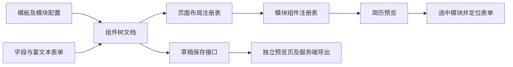
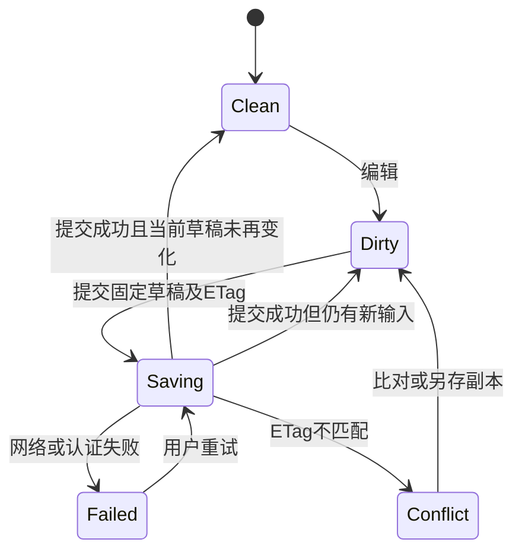

# 猫步简历源码拆解与 CVory 制作能力接入调研

CVory 源码对照引用提交 `c2a2eb3` 的历史快照；现行 NestJS 实现及验收范围见 [PROJECT](../../PROJECT.md) 和 [HANDOVER](../../HANDOVER.md)。

调研日期：2026-11-09（Asia/Shanghai）。主对象：[Hacker233/resume-design](https://github.com/Hacker233/resume-design)，产品名称为猫步简历。范围包含同类开源项目、功能拆解、公开运行观察、CVory 差距、实现接入及可靠性验收建议。

**当前执行前提：负责人明确指出 CVory 现有链路未经完整端到端验证，因此不能视为可靠基础。本文中的“已有”仅表示代码或测试定义存在；没有完整验收通过的能力均保持待验证状态。**

本文是正式调研报告，不修改原始需求，不把功能建议、架构建议或拟定指标当成已确认设计。采用后的完整目标见[业务需求 04](../requirement/04-个人CV制作与管理需求说明.md)及[PRD 导航](../prd/00-PRD导航.md)。当前合同见[产品设计 02](../design/02-CV制作管理与展示设计.md)，视觉仍以 [DESIGN](../../DESIGN.md) 为准。

## 1. 决策摘要

1. 猫步最值得学习的是**结构化简历编辑、模板与内容分工、预览定位、历史恢复入口**；不建议把整套 Vue 应用、运营后台或自由画布直接嵌入 CVory。
2. 公开仓库提供丰富前端代码，但 README 明确后端源码需另行获取。登录、云保存、AI 与服务端 PDF 的前端接口存在，**不等于开源仓库已经交付这些服务的完整可部署实现**。[M01][M02]
3. CVory 的目标基线为 Next.js/Tiptap/NestJS + TypeScript/MySQL；现有 FastAPI/Python 需兼容迁移；是否继续沿用每条链路，要经过真实完整链路的独立验证。优先处理保存离开、导入保真、正文校验、PDF 分页和多实例票据，再扩展功能。
4. 接入方式推荐**吸收合适的设计，选择性改造小模块，维护自己的数据合同与服务**。整站 fork、iframe 和双编辑器并行会引入另一套运行时、身份与数据模型，维护代价更大。
5. 同类项目中，Reactive Resume 更适合参考模板合同、导入候选与渲染诊断；OpenResume 更适合研究 PDF 解析分层；JSON Resume 适合作为外部交换适配，不替代内部 CV 模型。[R01][O01][J01]
6. 高可用要以数据不丢、失败可恢复、导出确定、跨用户隔离和部署可恢复的证据衡量，不能以模板数量、页面可打开或已有测试数衡量。

## 2. 调研方法、版本与完成边界

### 2.1 核查对象

| 对象 | 固定版本／观察位置 | 核查范围 |
| --- | --- | --- |
| 猫步公开源码 | `b87a87f8d8e90abe3dece2b134263f7914dfa2a1` | README、MIT、依赖、路由、组件树、编辑器、保存、历史、导入、打印和 AI 前端 |
| 猫步维护快照 | 4110 stars；最近推送 2026-04-20 UTC；最新发布标签 `release-v6.0.0`，2025-05-19 | GitHub 元数据；不能据此推断线上与源码完全一致 |
| 猫步公开网站 | `https://maobucv.com/` 及公开模板编辑入口 | Firecrawl 页面提取；REA 独立无登录浏览器观察及加载脚本采集 |
| CVory | 本地 HEAD `70938d2db519310fdc48158e818417e9436b0627`，按源码读取时点记录，工作区存在并行前端修改 | 制作、导入导出、保存、公开、打印及现有测试定义；应用端到端未验收 |
| Reactive Resume | `fed8ab5aa02248b6d2198757d4608cf6a700aedf` | 公开前后端、schema、导入、PDF、持久化源码 |
| OpenResume | `4f8255a2c763479837f69f1dccf2a3338730cd79` | 公开编辑、PDF、解析与浏览器持久化源码 |
| JSON Resume Schema | `b25e3f4bbafd349c2c5bbaa62602c03c228762db` | 职业数据 schema、校验器和迁移说明 |

主仓库在临时目录检出并按需读取，未安装或执行其项目脚本。GitHub 插件读取主项目和比较对象；GitHub API 补充版本、发布和问题；Firecrawl 核对站点入口和公开功能表述；Context7 查询 Tiptap 和 Playwright 官方文档。源码与工具原始输出不进入项目文档目录。

调研期间出现并行前端状态反馈修改，已保留且不计为本报告实施成果。交付前复核保存返回 true、返回页面调用 save 和校对清空 items 的关键分支仍存在；没有复核并行变更的全部行为。文中行号用于定位，后续验收应重新固定包含工作区修改的完整版本。

### 2.2 证据分级

| 标记 | 含义 | 可以支持的结论 |
| --- | --- | --- |
| S | 固定提交源码 | 某段代码、调用及数据结构存在；不能证明运行成功 |
| R | REA 实际浏览器观察 | 指定页面及观察窗口内出现的 UI／网络现象 |
| B | REA 对实际加载脚本的静态分析 | 交付脚本中的静态事实；不代表函数已执行 |
| L | CVory 合成数据离线复现 | 指定局部函数行为；不能替代 HTTP／数据库／浏览器验收 |
| D | README、网站或上游文档 | 产品宣称、使用说明、限制；不能自动视为实测结果 |
| P | 本报告提出的方案 | 待设计、实现及验证的建议 |

没有注册猫步账号，没有修改、保存、发布或下载其真实用户简历；没有调用 AI、支付或付费后端。公开模板的示例人物内容不转载。CVory 只进行了无数据库访问的合成正文校验复现，没有启动完整业务链路、修改真实数据或运行完整测试套件。

### 2.3 调研问题覆盖

| 问题 | 当前结果 |
| --- | --- |
| 公开了什么代码、依赖什么服务 | 已回答，见 §3 |
| 两种设计器如何工作 | 关键数据流已回答，见 §4；未覆盖每个模板变体 |
| 哪些功能适合 CVory | 已提出逐项建议，见 §6；不是范围确认 |
| 如何接入当前工程 | 已提出模块边界和备选方案，见 §8～§10 |
| 当前实现是否可靠 | 不能确认；发现局部问题及完整链路缺口，见 §7 |
| 如何建立高可用证据 | 已给出验证矩阵、观测与恢复方案，见 §11～§14 |
| 线上保存、AI、付费导出的成功率 | 未验证，需要独立授权和真实运行条件 |

### 2.4 当前要求的源码复核

GitHub 插件复核 main 仍是 `b87a87f8d8e90abe3dece2b134263f7914dfa2a1`。关键结论：Vue/wangEditor HTML 与 componentsTree 不是 Tiptap JSON；`AiJsonToMdDrawer` 的本地确定性转换不等于完整 Markdown 双向编辑；已查 JSON/已有简历导入入口不能证明 MD/DOCX/PDF 外部解析；`pdf.ts` 调用独立后端 PDF/PNG 接口，前端开源不足以复制其完整后端。它们对应的 CVory 能力仍需自建并逐项验收。

公开展示补充来源：[OnlineSettingDialog](https://github.com/Hacker233/resume-design/blob/b87a87f8d8e90abe3dece2b134263f7914dfa2a1/src/views/person/onlineResume/components/OnlineSettingDialog.vue)有公开开关、在线链接/二维码并调用更新 API；[onlinePreview](https://github.com/Hacker233/resume-design/blob/b87a87f8d8e90abe3dece2b134263f7914dfa2a1/src/views/onlinePreview/index.vue)按地址读取简历。可借鉴稳定地址与显式公开，不能由前端证明服务端字段脱敏、快照隔离或缓存撤回。

本文中 CVory 旧 HEAD/并行修改与离线复现仅说明对应采样版本，不等于当前 HEAD 的缺陷重验。当前未运行应用；需求 04 已明确 GitHub 登录/项目、双模式编辑、MD/DOCX/文字 PDF、PDF/PNG、首页、AI 与插件，不再把这些描述为可选扩展。OCR 首期不做；技术工具取舍见设计评审稿，实际实施状态只见 BACKLOG。

## 3. 猫步项目的真实开源和交付范围

### 3.1 产品定位与技术栈

README 将其定位为简历制作和模板下载网站。核查提交实际依赖为 Vue 3.5、Vite 7、TypeScript 5.8、Element Plus、Pinia、wangEditor、vuedraggable、Markdown-it 等；README 的 Vue3／Vite3 简介不能作为当前精确依赖版本。框架声明使用范围与最终锁定版本也不是同一概念。[M01][M02]

CVory 采样源码使用 React/Next.js、shadcn、Tiptap、FastAPI 和 MySQL；目标后端现选 NestJS + TypeScript，源码观察不代表已经迁移。模板功能可借鉴，Vue 组件不能直接作为 React 组件导入；Pinia store、wangEditor HTML、页面路由和其后端 API 也需要适配。

### 3.2 前端公开不等于全栈开源

公开目录中能找到页面、表单、管理后台界面和 API 包装；没有据以审查其完整账户、存储、AI、PDF 和运营业务实现的 NestJS 后端。README 给出了另行获取后端的入口。`src/config/index.ts` 通过 `VITE_SERVER_ADDRESS` 指定服务地址。[M01][M03]

因此，“下载仓库后即可独立拥有官网全部能力”不成立。官方后端不应被当成 CVory 的依赖或测试资源。若只复用前端，也要实现自有账户、数据授权、持久化和渲染合同。

### 3.3 许可与素材

仓库根 LICENSE 为 MIT。复制适用源码时需保留相应版权和许可信息；模板、字体、图标、示例头像、商标、官网资源及另行提供的后端，须分别核对来源和许可，不能根据根许可证推断全部第三方素材可任意使用。[M04]

建议建立模块级复用清单：上游 URL、固定 commit、文件范围、许可、修改目的、替换依赖和回归用例。当前没有把上游代码或素材拷入 CVory。

## 4. 源码拆解：从数据到结果

### 4.1 简历专用编辑器

其新版数据结构由 `IHJNewSchema` 描述，主要包括 `version`、`componentsTree`、页面 `props/css/config` 和模块自己的 `dataSource`。模块另有 `componentName`、`customProps`、样式及标题等配置。Pinia 的 `HJNewJsonStore` 保存整份编辑文档。[M05][M06]

链路如下：

`ModuleBox` 通过注册表选择模块组件，控制显示、选中和标题插槽；点击预览模块会选中对应 ID、展开配置并滚动表单。这种“看到哪里就编辑哪里”的联动值得保留。[M07]

`BasePage` 在正常文档流中排序模块；`LeftRightPage` 将模块分到左右列表并回写组件树。它们体现的是受限布局能力，适合职业简历。CVory 可以沿用自己的语义模块和 React 渲染器实现相近交互，不需要照搬整个组件树格式。[M08]

### 4.2 模块、样式和数据的耦合

猫步把模块内容、组件变体、字段开关、样式和页面配置一起保存在模板文档。优点是模板表达力强；代价是同一份职业经历可能与具体模块组件的字段结构绑定，跨模板迁移需要映射。[M05][M09]

CVory 更适合维持“职业内容为主、模板为视图”的模型：公司、日期、职责等字段不依赖某个 Vue／React 组件名。切换模板只能改变布局和样式，不能隐式改写职业事实或丢失条目。

### 4.3 富文本

`CommEditor` 使用 wangEditor，双向绑定 HTML 字符串，并提供字号、字体、列表、表格等能力；部分配置连接其上传接口。[M10]

适合借鉴的是工具条组织、字段旁辅助入口及即时预览；CVory 的正文权威源应继续按既有合同使用受限 Tiptap JSON。直接混存 HTML 和 Tiptap 会形成两套清洗、渲染、迁移与导出规则。

### 4.4 草稿和历史

新版导航组件对文档变化做 5 秒防抖保存，提交模板 ID、完整 JSON 和保存类型；另提供版本列表、回退和清空接口。保存成功后刷新版本历史。[M11][M12]

这证明前端具备入口与调用，不证明后端历史是原子快照、跨标签条件写入或永久保留。所查保存请求没有显式 ETag 条件；后端不公开，不能据此断言其服务器完全没有并发控制。

`new Promise(async resolve => ...)` 的保存包装在等待请求抛错时存在外层 Promise 不被正确拒绝的静态风险；必须通过故障注入确认，不能直接抄入我们自己的保存链路。5 秒防抖本身也不是数据不丢失保证。

### 4.5 分页和导出

专用编辑器按内容高度和固定 `1160px` 绘制分页提示、按页高扩展容器。它属于编辑预览的高度计算，不能据此证明 Chromium 导出时的真实换页位置一致。[M13]

PDF／PNG 路径将预览 URL、格式、页数等交给后台；新版 PDF 使用独立 `resumePreview` 页面。预览 PDF 的前端还有元数据与 Base64 通过特殊分隔串组合的协议。公开代码不足以确认后台的浏览器隔离、字体嵌入、超时、地址校验或资源预算。[M14][M15]

`html2canvas` 存在于依赖中，旧 `html2pdf.ts` 主要为注释代码；不能仅凭依赖表就把当前主要 PDF 路径描述成截图式导出。

### 4.6 JSON、Markdown 与已有简历导入

JSON 导出序列化其组件树文档；它是猫步自己的可编辑格式，既不是 CVory v1，也不是 JSON Resume 标准。旧导入对话框主要检查 JSON 语法，新版 JSON 编辑抽屉可整体替换 store；这些入口不构成完善的 schema 迁移与受限渲染合同。[M16]

源码还存在“导入已保存简历数据”的入口，查询当前用户已有简历后选择；这不等于任意 PDF、Word 或图片简历解析。README 的 Word／PPT 下载对应模板资源目录，不能理解为把当前编辑简历无损导出为 DOCX／PPTX。[M17][M18]

Markdown 转换实际走本地 `resumeJsonToMarkdown`。但抽屉先请求服务器流水号，之后完成本地转换并提前返回；后面的 AI 转换分支在该路径不可达。这提醒我们：**确定性的文件转换应能在没有模型、积分和额外云请求时工作**。[M19]

### 4.7 AI 功能

前端提供润色、创作、翻译、诊断、模型列表、流式结果和取消入口。诊断将简历转成 Markdown 后发送服务；存在积分和模型配置联动。[M20]

这些代码可用于研究“选择字段→生成候选→审阅”的交互。模型提示词、完整计费、数据保留、提供商失败恢复和生成质量不能从公开前端验证。AI 是否进入 CVory 产品范围仍需独立设计，不能因竞品具备而自动加入。

### 4.8 自由积木设计器

积木设计器按 widget 保存坐标、尺寸、层级、旋转与独立内容，并有拖拽缩放、图层和属性 setter。其目标接近自由画布，能覆盖海报等非简历内容。[M21]

对 CVory，任意定位会增加正文溢出、阅读顺序、移动编辑、键盘操作、分页和文本抽取的验证成本。常规职业简历应优先保证受限布局和语义内容；自由画布属于另一个产品决策，不建议首期引入。

## 5. REA 实际拆解结果与局限

本次遵循技能分工：完整公开源码使用普通仓库工具；REA 用于观察线上交付行为和分析浏览器实际加载脚本，没有对完整源码仓库机械执行 REA。

| 证据 | Evidence ID | 结论及边界 |
| --- | --- | --- |
| 首页受控浏览器观察 | `ev_5b3bb16916ac741f19c34e83a3e8103790158803ac540627d6941f0971565704` | 页面可加载，显示制作、AI、会员等入口；网络事件达到所选预算，捕获不完整 |
| 公开模板编辑入口观察 | `ev_48f03a8b811dc995ce4e2836876cb7977ecb08767bd1a96e2f9bc1f8f01e3487` | 出现结构化表单、预览、三页提示、历史／导出入口及未登录提醒；未操作保存、回退、导出或 AI |
| 实际加载脚本静态分析 | `ev_8f9f569f7e6a482aed16c8007e5b267b969ec7fee4af095caf47b889bc77aba5` | 选择草稿 API、简历 API、PDF 三个脚本，14,804 字节，3 个均解析成功；其余 26 个脚本未分析，整体覆盖为 partial |
| 简历 API 模块出向追踪 | `ev_5bb28c1dfd17365f38904c7a2d0eedf57b49fce732ff169a9b6faebd0a1551e1` | 2 个匹配、24 个追踪节点、23 条边；只是局部静态关系，不证明请求已执行成功 |

从 REA 的网络响应正文提取脚本字节，不重新请求私人接口：

| 交付脚本 | SHA-256 |
| --- | --- |
| `createTemplate-D4yNSfPO.js` | `54d226a27a747bc84da27515b976d6ae30c342e3570164fa6c67268ef818f3a0` |
| `resume-O4xaxZys.js` | `f782b96d18c2a506fe3846cc60b3d92711fecc5fab721297ea828cc1ba2e34dc` |
| `pdf-CMUYPxd9.js` | `2707d6b3d49e59fffdff84d6c20d8766f699fd52a197b1e6b90480a05181de5f` |

补充边界：普通 GET 获得的若干 JS 地址内容呈现为 HTML `pre` 包装，最初静态解析失败；解码文本曾用于辅助核查，但不作为原始交付字节。上表改以 REA 运行捕获的响应字节为准。对 API 字符串的单次图查询未匹配到节点，也不代表接口不存在；接口确认来自源码和实际脚本文本，不夸大图工具覆盖率。

两次浏览器均为独立临时会话，REA 报告已终止自有进程。没有接管负责人浏览器，也没有取得登录后的保存、历史恢复或导出质量证据。公开网页、源码提交和交付脚本之间仅对选定接口形成局部对应，未证明整站版本完全一致。

## 6. 哪些功能适合 CVory

“优先”仅表示研究建议；任务调度以 BACKLOG 为准。先验收核心链路，新增能力不得绕过可靠性门槛。

| 功能 | 用户价值 | 建议 | 必须通过的条件 |
| --- | --- | --- | --- |
| 结构化经历与受限富文本 | 减少录入错误并保留职业语义 | 核心，核查现有实现后完善 | 保存、重开、导出、公开内容一致 |
| 少量高质量模板 | 降低选择成本 | 优先保证现有三模板质量 | 换模板不丢条目，中文长内容可读 |
| 预览点击定位字段 | 降低寻找表单成本 | 值得吸收 | 标识稳定，隐藏模块和窄屏可处理 |
| 模块排序、显隐与自定义标题 | 适配不同用途 | 值得完善 | 隐藏不删除，导出遵循明确规则 |
| 经历条目复制和移动 | 减少重复编辑 | 按真实需求增加 | 新条目 ID 唯一，不与原条目互相覆盖 |
| 字号、行距、页边距、强调色 | 调整可读排版 | 受限参数化 | 设置范围合理，字体和打印一致 |
| 自动保存与状态反馈 | 降低丢稿风险 | 核心可靠性候选 | 条件写入、单飞、乱序保护和异常恢复 |
| 崩溃后草稿恢复 | 恢复未保存输入 | 高价值建议 | 账户隔离、恢复提示、注销和共享设备处理 |
| 历史快照和恢复为副本 | 修正误改 | 在保存基础可靠后增加 | 恢复不无条件覆盖新版本，保留来源版本 |
| JSON 可编辑备份 | 跨设备和长期恢复 | 核心，应先验收保真 | 结构和资源完整往返，版本迁移明确 |
| Markdown 交换 | 复用正文与接入求职服务 | 保持确定性本地转换 | 明示受限语义，不能冒充排版备份 |
| 可选文本、可搜索的 PDF | 招聘投递与打印 | 核心，应先验收 | 中文、分页、链接和字体通过实际文件检查 |
| PNG 图片导出 | 便于预览分享 | 次要，可延后 | 与 PDF 共用稳定输入，不阻塞主流程 |
| 猫步 JSON 导入 | 让已有用户迁移 | 有真实迁移需求再做 | 支持格式明确，不能笼统承诺所有猫步版本 |
| PDF／DOCX 内容导入 | 减少手动录入 | 单独评估，不与 JSON 导入混合宣传 | 候选校对、原文保留、低置信字段不自动写入 |
| JSON Resume 交换 | 与外部工具互通 | 可选适配器 | 自定义和富文本损失报告 |
| AI 字段润色／JD 建议 | 改善表达和岗位匹配 | 待单独确认 | 仅生成候选，不编经历，模型失败不影响编辑 |
| 全文翻译／AI 生成 | 多语种及初稿辅助 | 不作为首期可靠性依赖 | 新副本、可比对、事实复核和调用预算 |
| 公开简历 | 可控展示 | 先验收现有快照合同 | 私有保存不影响已公开内容，撤回有效 |
| Word／PPT 模板下载站 | 资源运营 | 不建议引入 | 与当前制作主任务关系弱 |
| 积分、签到、邀请、会员 | 商业运营 | 当前范围外 | 不应成为本地保存、导出的技术依赖 |
| 评论、社区、素材市场 | 运营增长 | 当前范围外 | 避免增加审核和维护工作 |
| 自由画布及通用积木 | 视觉自由度 | 不建议首期 | 需独立论证阅读顺序、分页与无障碍 |
| 大型运营后台 | 配置整站内容 | 按实际运营需求演进 | 不把简历工具扩成 CMS |

## 7. CVory 当前实现盘点：代码存在，可靠性未成立

### 7.1 已有实现可以作为验证对象

| 链路 | 代码事实 | 本次结论 |
| --- | --- | --- |
| 编辑与保存 | draft／saved 分开；克隆提交内容；ETag 条件更新带 owner | 具备正确方向的机制，仍需跨层并发、故障和离开场景验收 |
| 模板与预览 | ResumeDocument、三模板、样式设置、PaperPreview | 渲染代码可复用，分页和内容保真尚不能据此确认 |
| 文件交换 | v1 JSON／Markdown、文件限额、校对另存、创建 requestId | 存在完整入口，校对和语义往返有缺口 |
| PDF | 固定已保存数据、打印票据、Chromium、字体及图片等待 | 存在生成链路，尚非多实例可靠实现 |
| 公开 | 服务端筛选和固定快照、匿名读取和撤回 | 机制存在，来源删除和并发行为仍需验证 |

定位：[保存 Hook](../../frontend/src/app/cvs/[id]/_components/use-cv-document.ts#L55)、[CV 服务](https://github.com/StephenQiu30/cvory/blob/c2a2eb35bb5c870d0460ba409b04b08cccfe792f/backend/app/services/cv_service.py#L208)、[打印 API](https://github.com/StephenQiu30/cvory/blob/c2a2eb35bb5c870d0460ba409b04b08cccfe792f/backend/app/api/pdf.py#L34)、[公开 API](https://github.com/StephenQiu30/cvory/blob/c2a2eb35bb5c870d0460ba409b04b08cccfe792f/backend/app/api/publication.py#L20)。

### 7.2 已确认的局部问题与代码推导风险

| 项目 | 证据与影响 | 证据等级／处理建议 |
| --- | --- | --- |
| 保存并返回期间继续输入 | save() 保留请求期间的新草稿但仍返回 true；调用方可能据此离开 | S：需要浏览器延迟请求复现；跳转必须确认最新草稿也已保存 |
| 崩溃恢复 | 草稿主要在页面内存，beforeunload 只是提醒 | S：不能宣称崩溃后可恢复；设计账户隔离的恢复缓存 |
| JSON 校对破坏条目 | 修改校对文本时写入 content 并清空 items | S：公司、日期、标签和富文本结构可能丢失，应改结构化校对 |
| 富文本异常类型 | marks 为数字时迭代抛 TypeError，非 doc 根可通过 | L：已用合成数据离线复现；HTTP 返回行为仍未验收 |
| 文档总量边界 | 单段内容有限额，未形成整份 sections／items／字符串总预算 | S：API 输入和渲染资源需统一上限 |
| Markdown 往返 | 有序列表、行内代码和硬换行的转换不完整 | S：建立支持子集和双向语义夹具 |
| PDF 打印票据 | 票据及并发槽存在请求进程内存 | S：多 worker／多副本回读可能找不到票据，横向扩容前必须处理 |
| 预览与打印分页 | 预览以 CSS columns 模拟页，打印用正常流和 @page | S：共享组件不足以证明分页一致，需要实际 PDF 对照 |
| PDF 取消 | 前端 AbortController 不等于后端 Chromium 停止 | S：需验证断开连接后资源释放和取消边界 |
| 公开来源删除 | 删除服务未检查当前公开来源，公开快照可继续独立存在 | S：代码与“先切换或撤回来源”的设计规则需对齐 |
| 发布／撤回竞争 | 缺少与 CV 保存同级的版本条件 | S：多标签旧操作覆盖新状态需独立验收 |

详细定位：[保存与返回](../../frontend/src/app/cvs/[id]/_components/cv-editor.tsx#L582)、[JSON 校对](../../frontend/src/components/resume/import-dialog.tsx#L161)、[富文本校验](https://github.com/StephenQiu30/cvory/blob/c2a2eb35bb5c870d0460ba409b04b08cccfe792f/backend/app/schemas/content.py#L6)、[结构化字段](https://github.com/StephenQiu30/cvory/blob/c2a2eb35bb5c870d0460ba409b04b08cccfe792f/backend/app/schemas/cv.py#L62)、[转换](../../frontend/src/lib/resume/files.ts#L187)、[进程内票据](https://github.com/StephenQiu30/cvory/blob/c2a2eb35bb5c870d0460ba409b04b08cccfe792f/backend/app/api/pdf.py#L17)、[预览分页](../../frontend/src/components/ui/paper-preview.tsx#L73)、[打印布局](../../frontend/src/components/resume/resume-document.tsx#L85)、[删除](https://github.com/StephenQiu30/cvory/blob/c2a2eb35bb5c870d0460ba409b04b08cccfe792f/backend/app/services/cv_service.py#L217)。

### 7.3 局部复现的准确结论

在现有 Python 环境中直接调用 validate_content，输入均为新造合成数据，未连接数据库：

| 输入 | 结果 |
| --- | --- |
| 合法 doc／paragraph／text | 接受 |
| text 节点 marks=1 | TypeError：整数不可迭代 |
| 根节点直接为 text | 接受 |

这支持修复类型与根结构校验的必要性。它不证明实际接口一定返回某个 HTTP 状态，也不代表其他导入、保存或渲染场景通过。

### 7.4 测试定义不能代替完整验收

已有保存期间输入、ETag、公开快照、文件合同和 PDF 测试定义，但覆盖范围不同。顺序请求不等于 MySQL 同时写入；PDF 文件头不等于分页、字体、链接与文本抽取正确；JSON 不改直接导入不等于修改校对后仍保真。

本次未重跑完整测试、未完成真实部署验收。因此不继承旧阶段“局部测试通过”作为当前链路可靠的结论；当前统一为待验收。

## 8. 实现与接入方式选择

| 方案 | 收益 | 主要代价 | 建议 |
| --- | --- | --- | --- |
| 整站 fork 猫步 | 获得大量现成前端 | Vue／Pinia、私有后端依赖、双账户和数据迁移，范围明显扩大 | 不优先 |
| iframe 嵌入官方站 | 表面接入快 | 控制不了后端、登录、数据与导出，故障无法独立处理 | 不采用为核心能力 |
| 自建猫步前端微应用 | 可以保留 Vue 编辑器 | 双框架、消息协议、认证桥和 schema 双维护 | 仅在确认需要完整自由设计器时重新论证 |
| 在 CVory 内改造适用模块 | 保留账户、内容和工程基线，范围清晰 | 需要重写框架相关视图及可靠性处理 | 推荐候选，先验证现有链路 |
| 完全重做制作系统 | 可清理技术债 | 重复已有功能，风险集中在迁移和验收 | 当前证据不足以支持 |

推荐原则：内容、编辑、模板、交换和输出保持清晰分工；不新增另一份“主简历”，不将官网 API 当作我们的服务依赖。任何保留或替换决定都由完整链路证据驱动。

## 9. 自有制作系统的模块方案

### 9.1 数据合同

沿用现有 profile／sections／styleSettings 语义结构，修订时通过对应设计和 OpenAPI 形成单一来源。Tiptap JSON 为受支持富文本的权威表示；模板组件名、像素坐标和任意 HTML 不进入职业事实字段。

建议补全以下约束：

- 文档和导入格式分别有明确版本；不支持的新版本拒绝或生成可校对候选，不静默删除字段。
- 模块和条目使用稳定 ID，复制生成新 ID；排序、显隐和样式变化不重建职业内容。
- 服务端验证根、父子关系、attrs、marks、URL 和总量；前端即时校验不替代服务端。
- 模板声明支持模块、字体、纸张与参数范围；缺少模块实现时保留内容并提示，不输出空白冒充成功。
- 内容保存、模板切换、导入确认和公开发布各自有原子边界；图片失败不能悄悄覆盖已有头像。

### 9.2 编辑与预览

继续在现有 CV 编辑路由组织模块、字段与白纸预览；吸收猫步的点击预览定位表单、模块显隐和受限排版。通用控件仍用 shadcn，富文本仍用 Tiptap；不复制 Element Plus／wangEditor 的 UI 和状态层。

表单、预览、导出读取同一份规范化输入。窄屏切换编辑／预览时保留焦点和未保存内容；键盘必须能够完成模块排序等关键任务，不把拖拽当作唯一入口。

### 9.3 模板

第一阶段只保证已有三模板：长中文、英文长词、列表、长链接、照片和多页内容。模板登记应能回答“这个模板支持哪些内容与布局”，不急于开放用户任意 JS／CSS。

允许样式预设和模板切换，但切换不自动改写语义正文。不同模板采用同一组合成文档验证，避免每个模板复制一套业务逻辑。

## 10. 外部格式和猫步数据的接入

建议适配流水线：识别格式／版本 → 受限解析 → 标准化候选＋损失报告 → 结构化校对 → 服务端统一校验 → 以 requestId 另存新 CV。

### 10.1 猫步 JSON 适配

| 猫步数据 | CVory 建议映射 | 不可直接复用的部分 |
| --- | --- | --- |
| 旧 ID／COMPONENTS 格式 | 独立旧版识别器 | 不能与新版 componentsTree 混读 |
| config.title | displayName | 不覆盖已有 CV 名称 |
| 基本资料 dataSource | profile | age、地区等字段按现有业务合同保留或报告损失 |
| 工作／教育／项目模块 | 对应 sections／items | 日期、公司、学校、职位需语义映射 |
| HTML 正文 | 受支持 Tiptap 节点 | 字体样式、表格、图片等超出子集要提示 |
| showModule／字段开关 | 已支持的可见性规则 | 不能把隐藏数据直接删除 |
| 组件树顺序 | 模块和条目顺序 | 左右栏、标题组件等不保证外观保真 |
| 自由 widget 坐标 | 暂不支持或提取为候选文字 | 不承诺转换成相同像素布局 |

支持清单应固定到实际样本与版本；猫步新版模块的具体 dataSource 结构不同，必须有真实公开格式夹具后才能实现。导入时不下载任意外部 URL，不能把原模板封面当作用户照片。

### 10.2 Markdown 与 JSON Resume

Markdown 用于正文交换，不承担完整恢复；明确列表、强调、代码、链接和换行的支持子集，未知语义给出提示。Tiptap 官方 Markdown 扩展仍有 beta／语法能力限制，不能直接承诺任意 Markdown 无损往返。[C02]

JSON Resume 是外部职业信息交换格式。适配时需对自定义模块、富文本和样式出具损失清单；导出 JSON Resume 不替代 CVory 自有完整备份。[J01]

### 10.3 PDF／Word 导入

这是新解析能力，不能以猫步的模板下载证明已有方案。建议按 PDF 文本层、坐标合行、章节识别、字段候选分层；DOCX 有独立适配；扫描件提示需要 OCR，不能假称已支持。

每个候选保留原文和不确定字段，失败可退到原文校对；解析器不能直接覆盖现有 CV。英文单栏解析结果不能外推到中文多栏，也不能只给一个总准确率掩盖关键字段错误。[O02]

## 11. 保存和恢复：先保证不会误报已保存

建议状态至少表达：未修改、未保存、保存中、仍有新修改、已保存、失败、冲突、登录失效。状态由当前草稿与实际提交版本决定，不能只看最近一次 HTTP 成功。

建议落实：

1. 单份 CV 只允许一个保存请求执行；期间的输入继续保留，后续保存发送最新草稿。
2. 引入可比较的本地修改序号；“保存并返回”只有最新序号得到确认才能跳转。弹窗关闭不取消这项条件。
3. ETag 在数据库条件更新生效；两个真实数据库连接同时写入时，不能出现两个成功但内容互相覆盖。
4. 重试创建和恢复副本带稳定 requestId；重复点击或响应丢失不能创建多份副本。
5. 崩溃恢复缓存按账户＋CV＋基础 ETag 隔离；进入页面先比对服务器版本，提供恢复选择，不静默覆盖。
6. 恢复缓存写入失败、磁盘配额和隐私模式有明确提示；退出、切换账户、注销及共享设备的清理规则在实施前确定。
7. 真正历史快照与“命名副本”区分；历史恢复优先恢复为新副本，直接回退需检查当前版本。

这些是待实现的建议，不表示当前已具备自动保存、崩溃恢复或历史版本功能。

## 12. PDF 与分页：建立确定的输出链路

### 12.1 固定输入与结果

建议导出绑定 owner、CV、已保存版本、模板版本及资源清单；生成期间继续编辑不能混入。输出记录内容哈希、渲染器版本和结果状态，便于核对失败和复现。文件头、非空 Blob 和下载按钮都不足以判定正确。

当前 Playwright 路径可作为候选：官方支持 print media、CSS 页尺寸和背景输出，不需要为了跟随竞品立即替换。[C01]

### 12.2 预览和实际文件的一致性

- 同一输入先检查结构语义，再检查实际导出的页数、文字顺序、链接、图片和裁切。
- 屏幕预览若使用另一种分页机制，必须明确它是近似预览；精确模式可展示实际 PDF 或同一渲染结果。
- 不把固定像素分隔线当作分页算法；中文字体、长条目、图片解码和不同字号都会改变高度。
- 对短模块设置标题随首段、条目尽量不拆；超过一页的长条目必须允许有规则地拆分，不能因 avoid 规则出现整页空白或溢出。
- 不用“强压一页”替代可读性；自动压缩必须受字号和行距下限控制，并可撤销。

### 12.3 多实例与资源隔离

当前进程内票据仅适用于受控单进程配置。多 worker／多副本前，建议用现有 MySQL 保存有 TTL 的私有打印快照／任务，或把输入交付给独立受控渲染进程；单纯加粘性会话不能覆盖进程重启。

渲染进程需要总并发预算、排队或明确繁忙响应、超时和任务回收。不要只把每进程两个槽当作全局限额。重试应关联同一任务和固定输入，避免重复占用资源。

打印页面来源由服务端固定，不能照搬接收任意 URL 的导出接口。资源使用受控地址或已验证内联资产，限制数量、解码体积和等待时间；明确失败而不是偷偷缺字、缺图。取消和客户端断开要验证后台是否继续占槽。

### 12.4 故障降级

PDF 服务故障时应保留编辑、JSON 备份和 Markdown 导出能力。可提供浏览器打印作为说明清楚的备用路径，但不能将其质量默认等同正式导出。PDF 失败不修改正文，也不撤回公开快照。

## 13. 高可用的运行与观测建议

“高可用”既包括服务能响应，也包括数据正确、失败可恢复。当前没有压力和故障恢复证据，不能宣称达到任何可用率。

| 关注点 | 建议机制 | 验证依据 |
| --- | --- | --- |
| 核心读写 | 有界请求、数据库事务、条件更新、连接池和健康检查 | 并发保存、断网、数据库中断和恢复 |
| 导入与图片 | 总量、深度、字段和资源预算，受限转换 | 畸形／超限输入不会变成不受控异常 |
| 渲染 | 独立资源预算、可识别任务状态、超时回收 | 杀死渲染进程后任务可结束且槽释放 |
| 多实例 | 共享必要状态，避免进程内票据承担跨进程合同 | 两个实例下回读打印上下文和恢复 |
| 私有数据 | owner 在服务端得到，日志不含正文和票据 | 跨账户访问、错误日志与缓存检查 |
| 发布和删除 | 明确版本及来源关联规则 | 旧标签操作、删除来源、撤回与注销竞争 |
| 备份恢复 | 数据库、私有文件和删除墓碑联合演练 | 从备份恢复后内容、图片、撤回和注销状态一致 |
| 变更发布 | 固定依赖和镜像，兼容性检查，可回退 | 旧文档在新旧渲染器中可读取 |

指标建议记录请求成功率与 P95、条件冲突次数、未保存状态持续时间、导入失败原因、PDF 排队／耗时／超时／崩溃／实际文件检查失败。排除用户取消、输入错误等情况的口径应公开，不能为了指标漂亮把服务失败归为“用户问题”。

SLO、恢复时间 RTO 和数据恢复点 RPO 应在测量、容量和备份方案明确后确定；目前不给出 99.9% 等未经验证的承诺。至少要求已确认保存的数据在正常重开、应用重启及部署重启后仍能读取；恢复能力须通过实际演练证明。

AI、图片导出和模板服务若未来独立部署，应失败隔离：不能让这些服务不可用导致正文无法编辑或备份。当前无需为调研预先引入 Redis、Kafka 或复杂任务平台。

## 14. 首要工作：完整链路验证矩阵

以下均为需要执行的验收，不是本报告宣称已通过的测试。使用独立数据库、合成人物和独立私有文件目录；自动化覆盖之后，还要有真实交付形态的浏览器与文件验证。

| 链路 | 必测触发 | 成功依据 |
| --- | --- | --- |
| 注册／登录→建 CV→编辑→保存→重开 | 页面刷新、应用重启、会话过期 | 每个字段、条目 ID、富文本和样式一致 |
| 保存与离开 | 响应延迟时继续输入、关闭弹窗、点击返回 | 新输入仍可恢复，不能误报全部已保存 |
| 并发保存 | 两标签、两用户、MySQL 两连接同时写同版本 | 合法一个成功、另一个冲突；本地内容保留 |
| 创建／另存 | 连续点击、响应丢失后重试 | 同 requestId 只创建一份 |
| 模板切换→重开 | 三模板互换、隐藏模块、空模块 | 内容无损，只有声明样式变化 |
| JSON 导出→导入→修改校对→另存→再导出 | 条目、日期、链接、图片、富文本混合 | 可恢复字段逐项相等，修改仅影响所改字段 |
| Markdown 双向交换 | 有序／无序列表、强调、代码、换行、URL | 声明子集语义一致，其他明确提示 |
| 富文本与大小边界 | 数字 marks、错误 attrs、错误根、超深和超大内容 | 受控校验错误，不写入、不崩溃 |
| PDF→文本及页面检查 | 中文／英文、1／2／5 页、超长条目、长链接、照片 | 页数、内容、顺序、字体、链接、裁切都正确 |
| PDF 并发与取消 | 多个用户、繁忙、浏览器崩溃、断开连接 | 不串文档、资源释放、失败状态准确 |
| 双实例打印 | 创建任务与取票据落到不同实例、进程重启 | 能取得固定输入或明确可恢复失败 |
| 私有／公开 | 保存私有修改、重新发布、撤回、删除来源 | 匿名只能读取被确认的公开快照 |
| 账户隔离 | 切换账号、恢复缓存、访问其他人的 CV／图片／票据 | 不显示、不导出、不恢复其他用户内容 |
| 备份恢复 | 恢复数据库和文件，重放注销墓碑 | 内容可读且已删除内容不重新公开 |
| 窄屏与键盘 | 手机切换预览、键盘编辑、输入法组合输入 | 焦点、内容和提交时机正确，无不可操作入口 |

文件夹具必须包含空白、长中文、多语言、损坏图片、缺字字体、跨页列表和用户自定义模块。PDF 应同时用文本提取与页面渲染检查；仅视觉截图也无法证明文字可选或阅读顺序正确。

## 15. 同类开源项目比较

| 项目 | 公开范围与许可 | 最有价值的参考 | 接入限制 |
| --- | --- | --- | --- |
| 猫步 resume-design | Vue 前端为主，MIT；完整后端另行获取 | 中文模块、受限模板、预览定位和历史入口 | 框架及 schema 不同，运营功能多 |
| Reactive Resume | React/Vite、Hono、PostgreSQL/Drizzle 等公开实现，MIT | 模板合同、布局元数据、导入候选、字体和渲染诊断 | 不是可直接替换的 Next.js 组件库，PDF 有 workspace 依赖 |
| OpenResume | Next.js 编辑／解析／PDF，AGPL-3.0 | PDF.js 文字坐标→合行→分区→字段的清晰分层 | 明确偏英文单栏，无多用户服务端保存；依赖较旧 |
| JSON Resume Schema | schema／validator，MIT；旧仓库已归档并给出新维护入口 | 职业字段交换 | 没有编辑器、分页和账户，不覆盖富文本及版式 |

Reactive Resume 核查提交已使用 **Forme／WASM**，浏览器 Worker 与服务端均有 PDF 入口，并有字体子集及缺字诊断；不能沿用旧版 Chromium 架构介绍。它的富文本字段以 HTML 为主，与 CVory Tiptap JSON 需要转换，当前没有充分证据支持整体替换渲染器。[R02][R03]

OpenResume 使用 React PDF 输出，屏幕预览有另一套表现方式；因此同样不能假定预览和 PDF 一致。它将全局状态写入 localStorage，不能当作 CVory 的账户隔离和可靠保存方案。AGPL 与 MIT 的使用条件不同，涉及复制、修改和网络交付时须按实际范围核对许可证。[O01][O03]

借鉴顺序建议：猫步的职业模块和交互 → Reactive Resume 的合同与可诊断输出 → OpenResume 的解析方法；避免同时把多个编辑器或渲染器合并进产品。

## 16. 与 BOSS 自主投递能力的衔接

制作能力应提供稳定的职业数据和输出产物，BOSS 执行端负责平台动作。连接点建议为：选定 CV 版本 → 用户明确的字段可见性 → 规范化文本／Markdown 和可投递 PDF → 投递任务绑定版本及文件哈希 → 记录真实送达阶段。

修改简历不能悄悄替换一个已审核投递任务的附件；同一任务不能一边以旧经历生成招呼、一边发送新版本 PDF。公开简历地址不代替私有附件，恢复草稿不能自动触发真实投递。

AI 与匹配已纳入明确范围，输出为可比较候选，不自动编造履历、覆盖主简历或直接发给 HR。BOSS 方案仍见[调研 03](03-BOSS直聘自动投递简历方案与自研可行性调研.md)，这里不重复实现其平台适配。

## 17. 分阶段实施建议与决策条件

| 阶段 | 可独立验收的用户结果 | 进入后续的条件 |
| --- | --- | --- |
| 验证现有完整链路 | 能可靠完成建简历、保存、重开、导入导出和公开／撤回 | §14 中的核心场景有浏览器、API、数据库和真实文件证据 |
| 修复并复验发现的缺口 | 保存不丢新输入，校对不丢结构，非法输入受控，打印状态正确 | 对每个缺口有复现与修复后回归；完整主链重新通过 |
| 完善受限编辑与模板 | 在少量模板中快速编辑、定位和调整版式 | 长文、多语言、窄屏、分页与文件内容一致 |
| 交付必需 MD/DOCX/文字 PDF 适配 | 外部文档能生成可校对候选并另存 | 公开格式夹具、损失报告、原文保留和权限通过 |
| 建立多实例及恢复能力 | 重启、扩容和渲染故障不造成数据混乱或不可恢复任务 | 双实例与备份恢复演练完成 |
| AI 及历史目标 | 在核心服务失败隔离的前提下提高效率 | 明确范围、成本、撤销和独立验收 |

这些是建议交付顺序，不是已批准的 PRD 或精确排期。采用后的技术合同由 design 维护，验收和执行步骤见 PRD／Plan，实施状态只在 BACKLOG；报告中的建议不自动成为已确认选型。

## 18. 当前结论与未决项

**可以决定：** 猫步有值得吸收的模块组织和编辑交互；公开前端不能替代完整自有服务；CVory 应先验证已有完整链路，再按证据改造和扩展。

**需要验证后决定：** 现有打印引擎是否满足质量与容量、预览采用近似还是精确分页、是否需要猫步格式迁移、是否加入真正历史版本和恢复缓存。

**尚未验证：** 猫步后端的事务／并发／授权／容灾、登录后保存及版本恢复、实际 PDF 质量、AI 效果与费用；CVory 的真实部署全链路、MySQL 同时写入、双实例渲染、备份恢复和公网运行。上述未知不以“开源成熟”或旧测试记录补齐。

## 19. 来源与复查入口

源码引用固定到被核查提交；网站和 Issue 为观察时点的外部资料，状态变化不自动改写结论。Issue 关闭不等于已独立证明修复。猫步公开报告涉及预览分页、断字和手机体验，可作为回归场景来源，不当作当前版本必现事实：[分页反馈 #229](https://github.com/Hacker233/resume-design/issues/229)、[多页断字 #226](https://github.com/Hacker233/resume-design/issues/226)、[手机体验 #231](https://github.com/Hacker233/resume-design/issues/231)。

[M01]: https://github.com/Hacker233/resume-design/blob/b87a87f8d8e90abe3dece2b134263f7914dfa2a1/README.md
[M02]: https://github.com/Hacker233/resume-design/blob/b87a87f8d8e90abe3dece2b134263f7914dfa2a1/package.json
[M03]: https://github.com/Hacker233/resume-design/blob/b87a87f8d8e90abe3dece2b134263f7914dfa2a1/src/config/index.ts
[M04]: https://github.com/Hacker233/resume-design/blob/b87a87f8d8e90abe3dece2b134263f7914dfa2a1/LICENSE
[M05]: https://github.com/Hacker233/resume-design/blob/b87a87f8d8e90abe3dece2b134263f7914dfa2a1/src/views/createTemplate/types/IHJNewSchema.ts
[M06]: https://github.com/Hacker233/resume-design/blob/b87a87f8d8e90abe3dece2b134263f7914dfa2a1/src/store/createTemplate.ts
[M07]: https://github.com/Hacker233/resume-design/blob/b87a87f8d8e90abe3dece2b134263f7914dfa2a1/src/views/createTemplate/designer/components/ModuleBox.vue
[M08]: https://github.com/Hacker233/resume-design/blob/b87a87f8d8e90abe3dece2b134263f7914dfa2a1/src/views/createTemplate/designer/pages/LeftRightPage.vue
[M09]: https://github.com/Hacker233/resume-design/blob/b87a87f8d8e90abe3dece2b134263f7914dfa2a1/src/views/createTemplate/designer/schema/commonDataSource.ts
[M10]: https://github.com/Hacker233/resume-design/blob/b87a87f8d8e90abe3dece2b134263f7914dfa2a1/src/components/CommEditor/CommEditor.vue
[M11]: https://github.com/Hacker233/resume-design/blob/b87a87f8d8e90abe3dece2b134263f7914dfa2a1/src/views/designerResume/components/NavBar.vue#L333
[M12]: https://github.com/Hacker233/resume-design/blob/b87a87f8d8e90abe3dece2b134263f7914dfa2a1/src/http/api/createTemplate.ts#L81
[M13]: https://github.com/Hacker233/resume-design/blob/b87a87f8d8e90abe3dece2b134263f7914dfa2a1/src/views/createTemplate/designer/components/ResumeRender.vue#L85
[M14]: https://github.com/Hacker233/resume-design/blob/b87a87f8d8e90abe3dece2b134263f7914dfa2a1/src/utils/pdf.ts
[M15]: https://github.com/Hacker233/resume-design/blob/b87a87f8d8e90abe3dece2b134263f7914dfa2a1/src/http/api/resume.ts#L89
[M16]: https://github.com/Hacker233/resume-design/blob/b87a87f8d8e90abe3dece2b134263f7914dfa2a1/src/views/createTemplate/designer/components/ViewJsonDrawer.vue#L51
[M17]: https://github.com/Hacker233/resume-design/blob/b87a87f8d8e90abe3dece2b134263f7914dfa2a1/src/views/designerResume/components/ImportOtherResumeDataDialog.vue
[M18]: https://github.com/Hacker233/resume-design/blob/b87a87f8d8e90abe3dece2b134263f7914dfa2a1/src/http/api/wordTemplate.ts
[M19]: https://github.com/Hacker233/resume-design/blob/b87a87f8d8e90abe3dece2b134263f7914dfa2a1/src/views/designerResume/components/AiJsonToMdDrawer.vue#L170
[M20]: https://github.com/Hacker233/resume-design/blob/b87a87f8d8e90abe3dece2b134263f7914dfa2a1/src/views/createTemplate/designer/components/AiOptimizeDrawer.vue#L121
[M21]: https://github.com/Hacker233/resume-design/blob/b87a87f8d8e90abe3dece2b134263f7914dfa2a1/src/views/LegoDesigner/schema/widgetConfig.ts
[R01]: https://github.com/reactive-resume/reactive-resume/blob/fed8ab5aa02248b6d2198757d4608cf6a700aedf/README.md
[R02]: https://github.com/reactive-resume/reactive-resume/blob/fed8ab5aa02248b6d2198757d4608cf6a700aedf/packages/pdf/src/browser.tsx
[R03]: https://github.com/reactive-resume/reactive-resume/blob/fed8ab5aa02248b6d2198757d4608cf6a700aedf/packages/schema/src/resume/data.ts
[O01]: https://github.com/xitanggg/open-resume/blob/4f8255a2c763479837f69f1dccf2a3338730cd79/README.md
[O02]: https://github.com/xitanggg/open-resume/blob/4f8255a2c763479837f69f1dccf2a3338730cd79/src/app/lib/parse-resume-from-pdf/index.ts
[O03]: https://github.com/xitanggg/open-resume/blob/4f8255a2c763479837f69f1dccf2a3338730cd79/LICENSE
[J01]: https://github.com/jsonresume/resume-schema/blob/b25e3f4bbafd349c2c5bbaa62602c03c228762db/README.md
[C01]: https://playwright.dev/python/docs/api/class-page#page-pdf
[C02]: https://tiptap.dev/docs/editor/markdown

[返回调研导航](00-调研导航.md)
