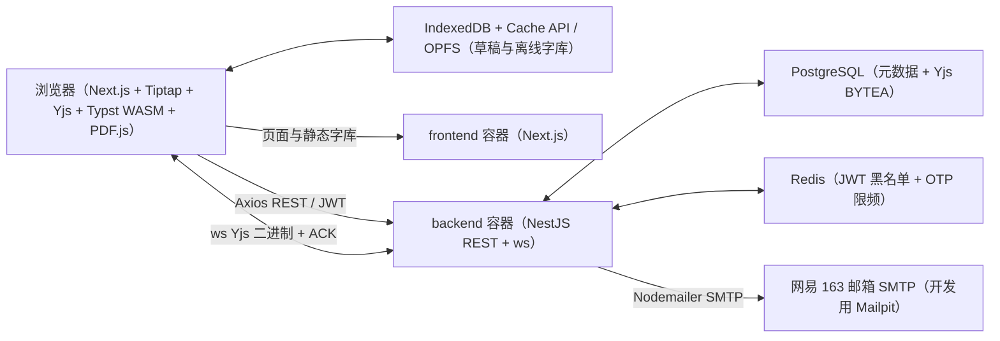

# 技术选型与系统架构设计

2026 年 11 月 24 日 · 首版工程技术选型已确认。上游为[在线简历制作设计](01-在线简历制作设计.md)、[首版 PRD](../prd/01-在线简历制作PRD.md) 与[开源编辑同步与 PDF 排版选型](../research/07-开源编辑同步与PDF排版选型.md)，11 月 25 日补充[开源项目与业务闭环调研](../research/08-开源简历项目与首版业务闭环.md)的采用结论。工作包落地见[执行计划](../plan/01-在线简历制作执行计划.md)。

## 1. 选型总览

首版坚持单仓库平级目录、Docker Compose 自托管容器部署、前后端全 TypeScript 栈，并围绕「纯浏览器离线高质 PDF 导出」与「本人跨设备强回执同步」收敛核心组件。

| 领域 | 选定方案 | 选型依据与职责 |
| --- | --- | --- |
| 部署形态 | Docker Compose 业务容器 + 复用本机已有基础服务 | Compose 仅编排 `frontend`、`backend`、`workspace` 三个业务服务；PostgreSQL 与 Redis 直接复用宿主机已有服务（容器内经 `host.docker.internal` 连接） |
| 仓库结构 | 平级独立目录 `frontend/` + `backend/` | 各自独立管理依赖与构建；前端遵循 **Vercel 设计规范**，后端遵循 **Google TypeScript Style Guide**；REST 契约通过 OpenAPI + `@umijs/openapi` 自动同步；严格执行单一现行契约，不做向后兼容（NFR-CV-03） |
| 前端框架与样式 | Next.js + shadcn/ui (Radix UI) + Tailwind CSS | 对齐 Vercel 无边框极简设计规范（NFR-CV-02），与知识库保持同栈，通过 Service Worker（Serwist / Workbox）保障离线重开 |
| 前端接口请求 | Axios + `@umijs/openapi` | 对接后端 `@nestjs/swagger` 生成强类型 API 客户端；Axios 拦截器统一处理 JWT Access / Refresh Token 自动续期 |
| 富文本与本地协同 | Tiptap（MIT 开源扩展）+ Yjs + `y-indexeddb` | 经历描述与技能正文通过 `@tiptap/extension-collaboration` 原生绑定 Yjs；本机草稿按游客与账号命名空间隔离存储 |
| PDF 生成引擎 | Typst WASM（`@myriaddreamin/typst.ts`）为主选 | 追求纯浏览器离线场景下最优中文排版与富文本渲染质量，原生支持中文断行、孤行控制与 `query` 条目坐标反查；若 T-CV-02 真机实测遇不可解阻断则降级 `pdf-lib + @pdf-lib/fontkit` |
| PDF 预览 | PDF.js | 直接渲染下载同源的 PDF 字节，叠加文本选择层与点击定位锚点 |
| 中文字库与离线缓存 | 自托管完整开源 OFL 静态字库（思源黑体 Noto Sans SC + 思源宋体 Noto Serif SC） | 按 Regular / Bold 拆分同源分发，进入编辑器按需后台拉取并持久化到 Cache API / OPFS，就绪后才标记该稿可离线续写与导出 |
| 后端框架 | NestJS（Node.js / TypeScript）+ `@nestjs/swagger` | 承载邮箱认证、岗位多稿管理、单稿幂等认领、OpenAPI 导出及同进程 Yjs 同步服务 |
| 持久化数据库 | PostgreSQL + Prisma | 存储用户、岗位稿件元数据（所有权、幂等认领键、软删除墓碑）以及 Yjs 二进制增量更新与快照（`BYTEA`） |
| 跨设备同步协议 | NestJS 原生 WebSocket（`ws`）+ 轻量 Yjs 二进制协议 | 每批更新携带 `clientSeq`，经契约与删除态校验写入 PostgreSQL 事务后返回显式 `ACK`，供客户端判断 AC-CV-07 的持久化状态 |
| 认证与缓存 | 无状态 JWT（Access + Refresh Token）+ Redis | Redis 维护登出 Token 黑名单、OTP 验证码 TTL 与发送限频；WebSocket 通过首帧认证消息校验短效 Access Token |
| 邮件发信服务 | 抽象邮件接口 + Nodemailer（标准 SMTP） | 联验与生产采用**网易 163 邮箱 SMTP**（`smtp.163.com`，SSL 465 端口 + 客户端授权码，环境变量注入）；本地开发默认对接 Docker Mailpit |

### 1.1 开源复用边界

| 领域 | 采用 | 简序负责的业务规则 |
| --- | --- | --- |
| 编辑与文档 | 沿用 shadcn/Radix、Tiptap、Yjs 和 y-indexeddb。参考 OpenResume 的访客表单及 Reactive Resume 的模板与岗位稿建模 | 定义五个固定章节、稳定条目 ID、独立岗位稿、显隐顺序、排版覆盖和当前文档契约。JSON Resume 用于对照字段语义 |
| 中文纸样与成品 | 沿用 Typst WASM 和 PDF.js。参考 RenderCV 的版式组织，以及 Resume For Free 的字库按需加载与编译资源缓存 | 三款中文 A4 的版式投影、连续中文分页、定位与重试。让预览和下载读取同一生成结果 |
| 邮箱与双设备 | 接入已有 NestJS 邮箱、稿件和认领接口，以及 Yjs 二进制更新。用 y-websocket 和 Hocuspocus 对照重连、鉴权与存储做法 | 保持按稿授权与账号隔离。重连用状态向量交换差异，界面根据能够确认本机最新一批修改的持久化回执显示同步状态 |

整站迁移的评估和许可证依据见[开源项目与业务闭环调研](../research/08-开源简历项目与首版业务闭环.md)。实施基线是现有前后端按模块复用。

## 2. 仓库结构与容器拓扑

仓库根目录保留 `workspace/` 独立知识库与根 `docker-compose.yml`，产品应用以平级独立目录落地：

```text
/
├── frontend/          # Next.js 产品应用（模板页、编辑器、我的简历、PWA、Typst WASM Worker）
├── backend/           # NestJS 业务 API 与原生 ws Yjs 同步服务（唯一现行 Prisma Schema，无迁移文件）
├── workspace/         # Fumadocs 知识库（保持独立）
├── docker-compose.yml # 仅编排 frontend / backend / workspace 业务容器（PostgreSQL 与 Redis 复用宿主机已有服务）
└── BACKLOG.md         # 工作项进度追踪
```



## 3. 前端与富文本离线架构（`frontend/`）

### 3.1 页面、接口与离线重开

- **路由与视图**：沿用 `/`（模板页）、`/resume/:id`（编辑页）、`/resumes`（我的简历），桌面 1200px 起测三栏无边框布局，手机 390px 采用填写／预览双视图。
- **接口契约**：由 `backend/` 暴露 OpenAPI JSON，前端通过 `@umijs/openapi` 生成请求函数与类型，Axios 拦截器自动附带 `Authorization: Bearer <accessToken>` 并在 401 时基于 Refresh Token 单飞续期；退出登录时清空内存 Token、关闭 WS 连接并重置预览状态。
- **离线重开（AC-CV-07）**：采用 Service Worker（Serwist / Workbox）预缓存应用壳、编辑页静态资源与 Typst WASM 运行时，确保已准备好的本机稿在断网后刷新或重新打开页面时无需依赖在线 RSC 请求即可进入编辑并导出 PDF。

### 3.2 Tiptap 富文本与 Yjs 模型边界

- **字段划分**：姓名、公司、岗位等可并发输入的字段用 `Y.Text`。日期、模板 ID、显隐和样式档位按稳定键存储。工作经历、项目经历及技能说明由 Tiptap 通过 `@tiptap/extension-collaboration` 绑定各自的 `Y.XmlFragment`。按两个独立客户端在同段追加不同文字做回归，确认两端合并后都能读回两份新增内容。[模型对照实验](../research/08-开源简历项目与首版业务闭环.md)
- **首版开放格式（全部采用 Tiptap MIT 开源扩展）**：加粗（Bold）、斜体（Italic）、下划线（Underline）、无序列表（BulletList）、有序列表（OrderedList）、超链接（Link）、局部文字颜色（TextStyle + Color）、局部高亮（Highlight）以及段落缩进（自定义缩进属性）。
- **输入法与单一现行契约**：遵循 NFR-CV-03，本机读取与远端同步只接受现行文档版本号与结构；中文 IME 组合输入期间不触发 PDF 渲染，选词结束后提交到 Yjs 并刷新快照。

## 4. PDF 排版、预览与中文字库管线

### 4.1 Typst WASM 主选路线（T-CV-02）

- **渲染流程**：在浏览器 Web Worker 中运行 `@myriaddreamin/typst.ts`，将当前 `Y.Doc` 的不可变快照（五章内容、Tiptap ProseMirror JSON、模板 ID 与有效个人排版覆盖值）编译为确定性的 Typst 源码并生成 A4 PDF 字节。
- **富文本映射**：Tiptap 节点与标记按白名单一对一映射为 Typst 排版指令（如 `#strong`、`#emph`、`#underline`、`#link`、`#text(fill: ...)`、`#highlight`、`#list`、`#enum`、`#pad`），禁用任意用户输入注入原始 Typst 脚本，所有正文文本按字面量转义。
- **条目定位锚点**：在每个章节与经历外层注入带稳定 ID 的 Typst `<label>`，编译同时通过 `typst query` 提取 `(itemId, page, x, y)` 纸面坐标，供 PDF.js 预览层实现跨页、缩放一致的点击定位。
- **兜底机制**：若 T-CV-02 在真实手机或低端浏览器实测中发现 WASM 内存、体积或兼容性存在不可解阻断，沿用同一份虚构样例与测试脚本降级评估 `pdf-lib + @pdf-lib/fontkit`。

### 4.2 自托管开源中文字库与离线就绪

- **字库选择**：采用开源可商用（SIL OFL）的**思源黑体（Noto Sans SC）**与**思源宋体（Noto Serif SC）**静态 TTF/OTF，按 Regular / Bold 拆分，存放于自托管同源静态路径并随构建附上许可证文件。
- **按需缓存**：首页不预加载重型中文字库；进入编辑器后，按当前模板及个人排版所需字重在后台拉取并持久化到 Cache API / OPFS。只有当稿件已写入 `y-indexeddb` 且应用壳、Typst 运行时及当前所需字库全部缓存就绪，界面才提示该稿可离线续写与导出；离线状态下切换至未缓存字体时保留当前可用版本并提示联网加载。

## 5. 后端服务、同步协议与安全（`backend/`）

### 5.1 数据模型与持久化（PostgreSQL + Prisma）

核心实体划分为四类。遵循不做向后兼容的工程原则，**不维护 `prisma/migrations/` 历史迁移文件**，以单一现行 `prisma/schema.prisma` 作为唯一真相源并通过 `prisma db push` 直接同步当前结构：

| 模型 | 关键字段与职责 |
| --- | --- |
| `User` | 邮箱唯一键、创建时间、最近登录时间 |
| `Resume` | 不可复用文档 ID、所有者 `userId`、稿名、当前模板 ID、软删除时间 `deletedAt`（删除墓碑）、更新时间 |
| `ResumeClaim` | `(userId, clientDraftId)` 复合唯一索引 + 对应 `resumeId`，保障游客单稿认领在回执丢失重试时严格幂等（AC-CV-08） |
| `ResumeYjsUpdate` / `ResumeYjsSnapshot` | 关联 `resumeId`、`clientSeq`、`BYTEA` 二进制更新与定期压缩快照，保障服务重启后完整恢复已回执数据 |

### 5.2 原生 WebSocket Yjs 同步与持久化回执

- **重连与对账**：设备重连按文档交换 Yjs 状态向量，补传本机尚未被远端覆盖的增量。客户端用当前文档和连接内仍在等待的批次匹配回执，另一个设备的序号用于该设备自身的请求追踪。
- **鉴权方式**：WebSocket 连接建立后，首帧发送 `AUTH` 消息携带短效 JWT Access Token（不置于 URL Query），服务端校验签名并查 Redis 黑名单，通过后再绑定当前 `userId` 与 `resumeId` 所有权。
- **写入与回执（AC-CV-07）**：客户端每次发送增量携带递增 `clientSeq` 与现行契约版本号。服务端先校验契约与 `Resume.deletedAt`：
  - 若契约不受支持，返回 `CONTRACT_UNSUPPORTED` 错误并拒绝写入（NFR-CV-03）；
  - 若稿件已被删除，返回 `DOC_DELETED` 信号并停止该稿同步，前端提示用户先导出离线未同步内容再清理本机副本（AC-CV-08）；
  - 校验通过后在 PostgreSQL 事务中写入 `ResumeYjsUpdate`，提交成功后返回 `ACK(resumeId, clientSeq)` 并广播给同账号其他在线设备；前端仅在收到覆盖最新本机变更的 `ACK` 时才显示「已同步」。

### 5.3 认证、限频与网易 163 邮箱发信

- **无状态 JWT + Redis**：Access Token 采用短有效期（如 15 分钟），Refresh Token 采用较长有效期（如 7–14 天）并支持轮换；退出登录或主动失效时将对应 Token `jti` 写入 Redis 黑名单（TTL 与剩余有效期一致），同时主动关闭该会话名下的活跃 WebSocket 连接。
- **OTP 验证码与限频**：6 位数字验证码以哈希形式存入 Redis（有效期 5–10 分钟，单次使用即删），按邮箱与 IP 维度在 Redis 中做发送频次与错误次数限制。
- **网易 163 邮箱 SMTP**：邮件模块通过统一 `MailProvider` 接口抽象，默认使用 `nodemailer` 对接标准 SMTP。联验与生产配置网易 163 邮箱（`SMTP_HOST=smtp.163.com`、`SMTP_PORT=465`、`SMTP_SECURE=true`，账号与客户端授权码全部由 `.env` 环境变量注入，不进入代码仓库）；本地开发通过环境变量切至 Docker 内置 Mailpit 便于调试。

## 6. 前置验证与风险控制

1. **T-CV-02（Typst WASM 与中文字库实测）**：须在真机与桌面浏览器完成 2,142 字连续中文、Tiptap 全量富文本（含高亮、颜色与缩进）、三款模板换页、`query` 坐标定位以及离线字库加载耗时的实测记录。
2. **T-CV-07（网易 163 邮箱真机联验）**：须使用真实测试邮箱与网易 163 发信账号走通一次完整验证码收发、发信限频、JWT 登出黑名单、WS 断网重连持久化回执与服务重启恢复流程，日志严格脱敏（不记录正文、验证码与真实邮箱）。
3. **单一现行契约演进**：首版前后端 `frontend/` 与 `backend/` 各自维护契约版本号常量与校验器，任何契约变更须同步更新两端校验与测试用例（CASE-CV-11），不保留历史兼容分支。

[返回设计导航](00-设计导航.md)
